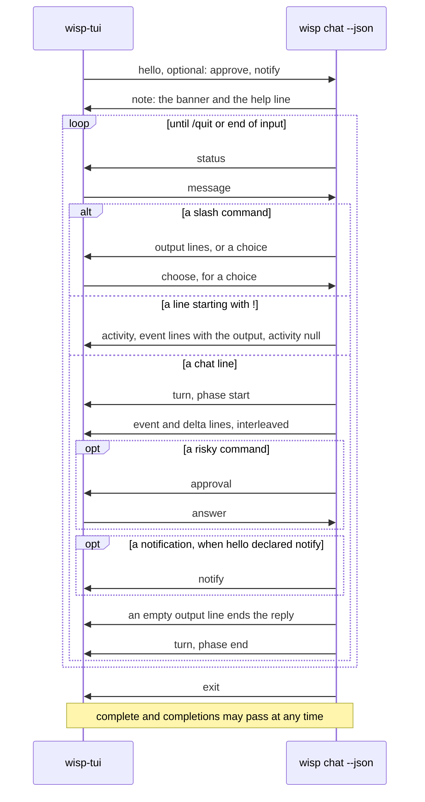

# wisp command reference

`wisp` runs Apple's on-device Foundation Model with tools. It has twenty-two subcommands (`respond`,
`chat`, `tools`, `models`, `mcp`, `logs`, `config`, `doctor`, `approvals`, `facts`, `questions`, `threads`, `notify`, `scan`,
`redact`, `watch`, `draft`, `classifier`, `completions`, `install`, `uninstall`, `update`), plus hidden maintainer ones under `classifier`; `respond` is the
default, so `wisp "<prompt>"` works.

## Subcommands

### `wisp respond [<prompt>]` (default)

One prompt in, one reply out. The prompt is read from stdin when omitted and stdin is a pipe; on a
terminal with no prompt, `wisp` prints its help instead of waiting for input.

| Flag | Meaning |
| --- | --- |
| `-i, --instructions <text>` | Instructions for this conversation, added under wisp's own system prompt and `config.json`'s `systemPromptExtension`. See [ADR 0017](decisions/0017-three-layer-instructions.md). |
| `--tool <name>` (repeatable) | Enable only these tools. Default: all registered tools but `memory`, `models`, and `ask`, which join them when `context.memory`, `tools.models`, and `tools.ask` are on; `--tool memory`, `--tool models`, or `--tool ask` names one either way ([tools/memory.md](tools/memory.md), [tools/models.md](tools/models.md), [tools/ask.md](tools/ask.md)). |
| `--no-tools` | Give the model no tools: a text-only conversation, which a model that declares no tool calling can still run. |
| `--stream` / `--no-stream` | Stream the reply as it is generated (default on). |
| `--unsafe` | Disable the `run_command` policy and sandbox (warns on stderr). |
| `-m, --model <model>` | `system` (default, on device), `private-cloud` (alias `pcc`; Apple Private Cloud Compute; data leaves the Mac, noted on stderr), or `<backend>:<name>` for a local runtime (`ollama:qwen3-coder`; `wisp models` lists every backend's models). A request that needs tool calling is refused before generation when the model does not declare it; see [ADR 0019](decisions/0019-model-backends.md). Defaults to `config.json`. |
| `-y, --yes` | Approve risky commands without asking. Without it, `respond` refuses commands at or above the approval threshold. |
| `--schema <path>` | A JSON Schema file; the reply is JSON of that shape through guided generation, printed whole (not streamed). The accepted subset and the capability rule are in [mcp.md](mcp.md), "Structured output". |

```
wisp "What is the date in Tokyo?"
echo "Summarise this" | wisp --tool current_date
wisp --no-stream --instructions "Answer in French" "How are you?"
wisp --no-tools --schema verdict.json "Which language is this: fn main() {}"
```

### `wisp chat`

Interactive session. Lines starting with `/` are commands; a line starting with `!` is a shell command you run
yourself ("Commands you run yourself", below); anything else goes to the model. Replies stream.

With the `ask` tool on (`tools.ask`, or `--tool ask`; [tools/ask.md](tools/ask.md)) the model can ask you one question
mid-turn: the chat shows it under `? the model asks`, numbered options with `none of these` last, and waits for
your line as long as you take (`inquiry.timeoutSeconds` sets a deadline); Enter alone declines, and Ctrl-C stops
the turn as it does elsewhere ([ADR 0062](decisions/0062-the-inquiry-verb.md)). `wisp-tui` shows the same question
as a picker titled "the model asks".

When the configured model (`config.json`'s `model`) is unavailable as chat starts, Ollama not running, say, chat
starts on `system` instead and says so before the first prompt, so you reach `/model`:

```
ollama:granite4.1:8b is unavailable (no Ollama server at http://127.0.0.1:11434: Could not connect to the server);
using system. /model ollama:granite4.1:8b once Ollama is running
```

It is recorded as `model.fallback` ([logging.md](logging.md)). A model named with `--model` is not replaced: chat
fails as before, since you asked for that one, and so it does when `system` is unavailable or disabled too.
`wisp respond` and MCP `respond` never fall back ([ADR 0056](decisions/0056-models-enabled-and-disabled.md)).

On a terminal, when `wisp-tui` is installed beside `wisp`, or in a `bin` beside the folder `wisp` is in (the
Homebrew formula installs `wisp` in `libexec` and `wisp-tui` in `bin`), `wisp chat` hands the session to it;
`wisp doctor`'s `front end` finding says where it found it, or where it looked: on the alternate screen, the
conversation is drawn in a pane of its own above a band with the reply in progress, an approval dialog, the input,
and the status ([ADR 0029](decisions/0029-tui-front-end.md), [ADR 0068](decisions/0068-the-conversation-in-a-pane.md)). `--plain` keeps the line-based chat below; a piped
session is always plain. `wisp-tui` takes the same arguments as `wisp chat` and can be run directly. It
starts `wisp chat --json` under the name `wisp chat (tui)`, which `ps` shows; wisp finds its own executable by
the kernel's path, never by that name ([ADR 0061](decisions/0061-process-names-set-at-spawn.md)).
In `wisp-tui`, Up and Down recall the lines submitted this session (the latest 100, a line repeating
the one before it kept once): Up from a fresh line keeps what was typed as a draft, and Down past the
newest line brings it back. In a message of several rows they first move the cursor a row, keeping its
column; recall begins from the first row (Up) or the last (Down). Down from the last row of a fresh line
moves the focus to the status bar ("The status bar", below). The plain chat reads whole lines and has no recall; `/history` lists them
in both. While a command you typed after `!` runs, or a model's turn, the first Ctrl-C (or Ctrl-D) stops it instead
and a second quits ("Commands you run yourself" and "Stopping a turn", below). Ctrl-C or Ctrl-D with nothing open leaves `wisp-tui`: it sends `/quit` (so the transcript is
saved, as in the plain chat), closes wisp's input, and waits up to five seconds for wisp to exit before
stopping it. Anything wisp wrote to stderr that was not yet shown, such as why it could not start, is
printed after the conversation, and `wisp-tui` exits with wisp's status when wisp failed (1 when it had
to be stopped).

The pane follows the end of the conversation. PageUp and PageDown (with no panel open) scroll it; scrolling back to
the end follows again. A tool's output, or a stretch of the model's thinking, longer than `shownOutputLines` (20)
folds to an info line and its last three lines, where a build's or a test run's result is: `▸ 248 lines · 12.0 KiB ·
exit 0`, the exit status in ember when it is not 0. When wisp held part of the output back (the event carries its
first 16 KiB), the info line ends `ctrl-o pages it` and no lines follow, since what is here is its start. The bodies
held are bounded at 32 MiB together; past that the oldest are let go, keeping their info lines.

Each part of the conversation is an element: a line you sent, a tool call with its output, a stretch of thinking, a
reply, a run of notes. Shift-Up from the input selects the last, marked `▌` down its left edge, and the row above the
input lists the keys while one is selected:

| Keys | Effect |
| --- | --- |
| Shift-Up, Shift-Down (or Up, Down) | The previous or next element, brought into view; Shift-Up from the input selects the last. |
| Shift-Right, Right | Unfold the element's output or thinking: all of what the event carried, under `▾`. |
| Shift-Left, Left | Fold it again. |
| Enter | Unfold or fold. |
| Ctrl-O | The element's output whole in the panel, paged from wisp, as for the last output. |
| Ctrl-Y | Copy the element to the clipboard (below). |
| PageUp, PageDown | Scroll the pane. |
| Esc | Back to the input. |
| A character, or any other key | Back to the input, where it does what it always does, so nothing typed is lost. |

Ctrl-Y copies the selected element, or from the input the last reply, to the clipboard: its lines as plain text (a
reply's Markdown as the model wrote it) and its output whole as the event carried it, folded or not, up to 1 MiB. It
goes through the terminal, as OSC 52, so it works over ssh too; a terminal that does not take OSC 52, or has it turned
off, copies nothing. The row above the input says what was copied and its size until the next key.

The mouse stays the terminal's, so dragging selects text as usual; the wheel does not scroll
the pane, and `wisp-tui` turns off the terminal's alternate scroll mode while it runs, so the wheel is never sent as
Up and Down, which would recall earlier input. On quitting, once the alternate screen is left, the conversation is printed into the terminal's
scrollback as the pane last drew it, in its colours, so the terminal's own search and selection reach it again; the
saved thread and the audit log keep it whole.

`wisp-tui`'s input edits in place, with readline's keys:

| Keys | Effect |
| --- | --- |
| Left, Right | Move a character. |
| Alt-Left, Alt-Right (or Ctrl-), Alt-B, Alt-F | Move a word. macOS terminals send Alt-B and Alt-F for Option-Left and Option-Right. |
| Home, End, Ctrl-A, Ctrl-E | Move to the start or end. |
| Backspace, Delete | Delete the character before or at the cursor. |
| Ctrl-W, Alt-Backspace | Delete back to the previous whitespace. |
| Ctrl-U, Ctrl-K | Delete to the start or to the end. |
| Alt-Enter | A newline, for a message of several lines. |
| Paste | Inserted whole (bracketed paste), newlines kept, so pasting never sends. |
| Tab | Complete the slash command being typed: the command, `/config`'s words, a setting, a setting's values, `/approvals`'s words, the approval ids after `/approvals revoke`, and the waiting commands' ids after `/approvals approve` or `deny` (then a scope), `/facts`' words and the waiting facts' ids after `/facts keep` or `drop`, `/questions`' words and the waiting questions' ids after `/questions answer` or `decline`, a model after `/model`, a view after `/inspect` (`next` or `turns` after `/inspect context`, `all` after `/inspect facts` or `/inspect summary`), a subject kind, a fact id, or `delete` after `/fact`, a fact id after `/fact delete`, and a scope after `/fact ID`, and a session id after `/audit`. One match fills in; several fill in what they share and show above the input, and Tab again cycles through them. |

Two keys open a panel over the band, a rounded border around up to 16 rows, with its keys in the bottom
border: Up and Down scroll a row, PageUp and PageDown a page, and Esc (or the key that opened it) closes
it. Typing is held while it is open; an approval or a choice arriving closes it and takes its place.

| Keys | Panel |
| --- | --- |
| Ctrl-O | The last tool output in full, or the selected element's. In the pane a long output folds to an info line and its last lines (above); this panel shows the whole. The panel opens on what the event carried and asks wisp for the whole (an `output` line, below): when the model was given only part of the output and the output store holds the rest, the whole replaces it under wisp's line saying so (`output 3f9a2c1b from run_command: the whole of it, 30,000 lines, 2.1 MiB, from the output store`), a page of 64 KiB at a time; scrolling to the end of the pages held asks for the next, scrolling to the top for the one before, and the panel holds at most four, so a 16 MiB output is never held whole. Its title says which pages it holds (`output · pages 2–5 of 33`). When the store has nothing, the line says why (nothing was held back, the audit was off, or the output was swept) above what the tool returned. |
| Ctrl-T | The model's context, live: what the next request carries (`/inspect context next`), at no model cost. Left steps back a turn to the context composed at that turn's start (`/inspect context N`), Right forward and past the latest turn back to the next request. `/inspect context turns` typed shows the turn list in the same panel. Only between turns. |

#### The status bar

The status row under `wisp-tui`'s input is a bar whose items open things ([ADR 0029](decisions/0029-tui-front-end.md),
amended 2026-10-12). Down from the input's last row (an empty box or a one-line one is on its last row) moves the
focus to its first item, the model; the row above the input then names the keys and what Enter does, and the input
keeps its line and cursor, without the terminal's cursor in it. The item with the focus is drawn in black on its own
colour (amber for approvals).

| Item | Shown | Enter or Space |
| --- | --- | --- |
| The model (`system`) | Always | Sends `/model`, which in `wisp-tui` offers the models it can switch to in a picker, the one in use marked; choosing one switches as `/model NAME` does, and Esc leaves it (`model unchanged`). |
| The context gauge (`15% used`) | When wisp reports it | The model's context in the panel, as Ctrl-T opens it. |
| Thinking (`(off)`, after the model) | For a model that can think and has a setting for it | Sends `/think`, which offers `on`, `off`, and the runtime's levels in a picker, the current one marked. |
| `questions: N` | While the model's questions wait for you: the one on screen and those queued (one from `wisp mcp` waits while a line is typed) | The first waiting question's picker, titled "the model asks", answered (or declined with Esc) with the picker's own keys; the rest stay counted. |
| `approvals: N`, in amber | While approvals (commands, and facts to keep) wait: the dialog on screen and those queued | The first waiting approval's dialog. It takes its keys only after its half second of grace, as one that arrives does, so neither the key that opened it nor one pressed straight after answers it. |
| The last turn (`last:3.1s`) | Once a turn has ended | The turn list (`/inspect context turns`) in the panel. |

The directory, the branch, and the approval mode are not items: there is no view of theirs to open.

| Keys, while the bar has the focus | Effect |
| --- | --- |
| Left, Right (with Alt or Ctrl too) | The previous or next item, stopping at the ends. |
| Tab, Shift-Tab | The next or previous item, wrapping around. |
| Home, End | The first or last item. |
| Enter, Space | Open the item; the focus returns to the input. |
| Up, Esc | Back to the input, its line and cursor as they were. |
| A character, an edit, or a paste | Back to the input, where it goes in, so nothing typed is lost. |
| Ctrl-C, Ctrl-O, Ctrl-T | What they do from the input. |

A picker that opens over a line being typed (from the bar, or the one `/model` sends) puts the line aside and gives
it back when it closes, so a typed answer starts empty and the draft is never lost. A dialog, a choice, or the panel
that opens while the bar has the focus takes the keys, and the focus returns to the input once it closes. The bar
takes the focus only between turns, with nothing open over the input; an item that goes while it has the focus (its
last question answered elsewhere) passes the focus to the model.

A line you send goes into the conversation styled like the input it came from, a shade darker: its tint
edge to edge, halfway from the input's blue to black, with half-block strips above and below.
The turn that answers it is in parts, each set apart from the one before by a blank line: a stretch of thinking
(`∴`), each tool call (`⚙`, with its `↳` result and output), the reply, and the `ran:` line under it with the notes
that follow. The first part sits straight under your line, whose strip already sets it apart. The plain chat spaces
a turn the same way: the first part under the line you typed, a blank line before each later tool call or stretch of
thinking, before the reply, and before the footer (what the turn ran, its time, and its tokens). `wisp chat --json`
sends no blank lines; a front end lays out its own.

Command mode is a state of `wisp-tui`'s input box ([ADR 0049](decisions/0049-commands-typed-in-chat.md)).
Typing `!` at the start of the line, into an empty box or in front of what you have typed, switches it to
command mode: the `!` is the switch, not text, the box turns a muted pale amber (`command`, #E8B577) with
bold black text, its marker becomes `!`, and what you type is the command. A `!` typed after other text,
or at the start in command mode, stays text. Backspace with the cursor at the start of the line switches
back to the normal prompt, keeping what you typed as ordinary text, so a stray `!` costs one key; Delete
in an empty box does the same. A paste that starts with `!` at the start of the line enters command mode
the same way. Enter runs the command and the box returns to the normal prompt; an empty command sends
nothing. In the conversation the command's line is a stripe in a darker, faded shade of the same colour
(`commandSent`, #745A3C) with light text, `! git status --short`, as a prompt's is the darker shade of the
input. Up and Down bring a command back in command mode.

Outside mode is the step after command mode, for a command you run outside the sandbox
([ADR 0064](decisions/0064-an-approved-run-outside-the-sandbox.md), amended 2026-10-14). Typing `!` at the start of
the line in command mode switches to it: the box turns a muted red (`outside`, #D27068, darker and greyer than the
error colour) with black text, its marker becomes `!!`, and the hint reads `Run a command yourself OUTSIDE the
sandbox: it may write anywhere you can`. A `!` at the start in outside mode is text. Backspace at the start of the
line (Delete in an empty box) steps back one mode, to command mode's amber, and another to the normal prompt, keeping
what you typed. A paste at the start of the line steps up a mode for each `!` it starts with, as typing them does:
`!!brew upgrade` pasted into an empty box enters outside mode with `brew upgrade`, and `!x` pasted at the start in
command mode enters outside mode with `x`. Enter sends `!!brew upgrade`; its line in the conversation is `!! brew upgrade` on
the outside colour's darker shade (`outsideSent`, #693834), and Up and Down bring it back in outside mode. Text in
the normal box that starts with `!!` (pasted after a space, say) is not sent unseen: Enter puts the box in outside
mode with the rest, and a second Enter sends it. A command mode line whose text starts with `!` is sent as `! !x`, so
it runs in the sandbox as the amber box showed. The colours are a first proposal, not yet chosen from renders as
command mode's were.

Help mode is `?` typed at the start of the line in the normal box: the `?` is the switch, the box turns grey (`help`,
#9AA3A9, `wisp-tui`'s alone) with black text, and the placeholder reads `Enter for every command, or a word to find
the ones that mention it`. Enter on an empty box shows `/help`; a word, `think`, sends `?think`, which shows only the
commands and keys whose lines mention it, in any case. A `!` in help mode is text, and Backspace at the start of the
line (Delete in an empty box) returns to the normal box. A `?` after other text is text, so a question can end with
one. Its line in the conversation is `? think` (or `?` alone) on the help colour's darker shade, a dark grey (`helpSent`,
#4D5254). Up and Down bring `?think` back in help mode.

While a turn runs, or a command you typed, the input box is inactive: dimmed, with what wisp is doing in
place of the cursor, `… working: read_file README.md` or `… working: waiting for the model`; for a command you
typed, which has no time limit, what it runs, for how long, and how to stop it, `… running ollama pull
hf.co/… · 42 s · Ctrl-C stops it`, ticking each second, then `… stopping … · Ctrl-C again quits` once you have;
a turn you stopped reads `stopping the turn · Ctrl-C again quits` until it ends. Keys typed meanwhile are held, not shown as typed and not lost: the box says how many
(`· 3 keys held`), and they are applied in order when the turn ends, as if typed then (a held `!` into the
empty box enters command mode). Held keys only ever go into the input box: when the turn ends with an
approval or a choice open, they stay held until it closes, so a letter typed ahead never answers a dialog.
Enter is not held: a message is sent only once you can see it.

The input grows a row for each line or wrapped line of the message, up to six rows; beyond that it
scrolls within them to keep the cursor's row in sight. It shrinks back only once the input is empty, as
it is when the message is sent, so deleting across a wrap does not resize the band as you type. The
terminal's own cursor marks where typing goes. ratatui fixes an inline band's height when it is made, so
the band is redrawn at the new height; after it shrinks it can sit a row or two above the bottom of the
terminal until the next output closes the gap. Each frame is sent as one synchronized update, so a
terminal that supports it (Ghostty, iTerm2, kitty, WezTerm, Alacritty) shows only finished frames, and
lines are added above the band by scrolling a region rather than redrawing it. The band is redrawn only
when something changes it (a line from wisp, a key, a paste, a resize), never while idle. Keys other than a dialog's answers are ignored while an approval is asked;
while a turn runs they are held, as above.

An approval takes the input's place in the band: a rounded border in the level's colour, titled with
the level, around the command (wrapped to four rows), the whole line when the command is one part of
it, the directory, each reason, the pattern the answer is remembered under, and the keys, as `wisp
chat` offers them. Lines too long for the dialog end in an ellipsis. The answer is recorded in the
conversation as one line, `✓ approved for this session: git push` or `⚠ refused: …` (`⚠ approved once, outside the
sandbox: …` for a run outside it, which deserves the warning), and the band gives
the rows back to the input. Ctrl-C or Ctrl-D refuses. A dialog takes its keys only once the keyboard has
been quiet for half a second after it appears: a key pressed sooner was meant for the input (you were
typing when it came up), so it is held for the box, as keys are while a turn runs, and the half second
starts again. Typing on therefore never answers a dialog; pausing to read it, then pressing a key, does.
Ctrl-C refuses at once. An approval from `wisp mcp` that arrives while the input box has text does not
take the box over: a note says it waits (`⚠ waiting in wisp mcp: git push · its dialog opens when the
input is empty, or from the status bar`), the status bar counts it (`approvals: 1`, in amber), and its
dialog opens once the box is empty, when the line is sent or cleared, or at once from the status bar's
`approvals` item, the line you were typing kept. An approval or a choice that stops waiting (answered elsewhere, or its
`approval.timeoutSeconds` passed) closes with `⚠ no longer waiting: …`.

The plain chat (`--plain`, or `wisp-tui` not installed) has no dialog for these, since it reads a line at a time.
Before each prompt it notes, once, each request newly waiting in a `wisp mcp` server, a command to approve, a
fact to keep, or a question the model asks ([tools/ask.md](tools/ask.md)), with its id; the first of each kind also
says how to answer:

```
⚠ a1b2c3d4 waiting in wisp mcp (claude-code, thread git): run git push origin main in ~/src/wisp, moderate
  answer with /approvals approve ID [once|session|project|always] or /approvals deny ID
⚠ 5e6f7a8b waiting in wisp mcp (claude-code, thread docs): keep as a permanent fact entity release codename = BLUE HERON, from model
  answer with /facts keep ID or /facts drop ID
? 9c0d1e2f waiting in wisp mcp (claude-code, thread git): the model asks: Which config? (~/.wisp | ./wisp.json)
  answer with /questions answer ID, which prompts for the answer, or /questions decline ID
```

A command the model asked to run outside the sandbox is noted as `run brew upgrade OUTSIDE THE SANDBOX, this
once, in ~/src/wisp, moderate`, and `/approvals approve` approves it once whatever scope you give, as `wisp
approvals approve` does ([ADR 0064](decisions/0064-an-approved-run-outside-the-sandbox.md)).

`/approvals approve`, `/approvals deny`, `/facts keep`, `/facts drop`, `/questions answer`, and `/questions
decline` answer one (without an id, they offer what waits to choose from), and `/approvals pending` lists
everything waiting. `/questions answer` shows the question as `wisp questions answer` does and reads your answer at
its own prompt, a number or an option for a choice, a line of text otherwise, Enter alone writing nothing, so the
answer is never part of a command line you typed. A request is noted only between
prompts: one that arrives while you are at the prompt is noted once you press Enter (an empty line will do), and
its notification announces it meanwhile. A request seen before and gone now is noted once with how it ended, read
from the audit log: `· a1b2c3d4 no longer waiting: answered in wisp-tui (git push origin main)`, `answered in the
client's dialog`, `its wait ran out unanswered`, `withdrawn: its server stopped`, for a question `answered in
wisp questions` or `declined in wisp-tui` from its `inquiry.settled`, or, when the log has no word of it,
`answered elsewhere or withdrawn`. One you answered in the chat is not noted again. The answer goes through the
same checks as `wisp approvals` and `wisp-tui` (still waiting, the right kind, bound to what was shown, the first
answer winning), is written with `via` `chat`, and is audited as `approval.answered` (`inquiry.answered` for a
question) on the chat's own session; a
fact whose server has stopped is kept by the chat itself, as `wisp facts keep` does. As with `wisp approvals`, the
chat answers only when its standard input is a terminal, so an agent piping lines into `wisp chat --plain` cannot
answer for you; such a chat still notes what waits, and says where to answer. The commands are typed lines, never
the model's: no tool reaches them ([ADR 0046](decisions/0046-approval-and-notifications-over-mcp.md), note of
2026-10-12). In `wisp-tui` the same commands answer from its input, written with `via` `tui`; its dialog stays the
usual way, and `/questions answer` there points to the question's picker, which already shows it (`/questions
decline` declines from the input).

A choice, such as `/config set approval.classifier` without a value, takes the input's place the same
way: a border titled `choose` around the question, up to eight options with `▸` on the highlighted one
and `*` on the value in force, and the keys. Up and Down move, Enter chooses, and Esc or Ctrl-C leaves
the setting as it was. Where the setting takes a typed value (a number, text, a model not listed), a
row below the options takes typing, and Enter with something typed sends that instead. In the plain
chat the same choice is a numbered list: type a number or a value, or press Enter to leave it; a line
starting with `/` leaves it too.

Replies are rendered as each line goes into the conversation, in the little Markdown the model writes:
`#` headings in bold, `-`, `*`, and `+` bullets as `•`, and `` `code` ``, `**strong**`, and `*emphasis*`
styled with their markers removed. A fenced block keeps its lines as they are, in the code colour, with
the fences dimmed; a fence left open closes at the end of the turn. Anything that is not clearly markup,
such as `2 * 3` or `snake_case`, is left as typed. The line still being streamed is shown raw until it
is complete.

Tool calls, thinking, and approvals stay in the quiet tone, with the words that say what happened in a colour of
their own: a call's `⚙` and tool name (`⚙ edit_file`) in the wisp blue, a stretch of thinking's `∴ thought` in a
grey, and an approval's mark and its words up to the colon (`✓ approved for this turn`, `⚠ waiting in wisp mcp`) in
the approvals' amber, or red when it was refused. The rest of each line, and every result and output under it, stays
quiet.

#### Commands you run yourself

A line that starts with `!` is a command you run, not a message: `! git status --short` and `!git status
--short` both run `git status --short` in the conversation's working directory, as `run_command` would, with
its output bound (the tail of each stream) but no timeout, and no model turn starts
([ADR 0049](decisions/0049-commands-typed-in-chat.md), amended 2026-10-09). A long command (`! ollama pull …`,
a build) runs until it ends or you stop it: Ctrl-C while it runs, in the plain chat and in `wisp-tui`, sends its
process group SIGTERM and, two seconds later, SIGKILL, so whatever it started stops too; its line then reads
`↳ exit -15 (stopped by you)` and the chat goes on, the model told of it as of any command you ran. Ctrl-C does
not quit chat while such a command runs; a second one, while it is still stopping, kills it at once and quits,
as a second Ctrl-C does during a model's turn; at the prompt Ctrl-C quits. While it runs the plain chat's working line says
`… 42 s · running ollama pull … · Ctrl-C stops it`, and after the first Ctrl-C notes `stopping ollama pull …;
Ctrl-C again quits`. Esc does not stop it, as it does not stop a turn. If `wisp-tui` quits or closes wisp's
input while one runs, wisp kills it, so none outlives the chat. A bare `!` runs nothing and says so. A `!` inside a
message is text. `wisp-tui` has a command mode for it (above); the plain chat, which has no box, colours the
line's prompt marker in the command colour once you press Enter.

A line that starts with `!!`, the two marks together, is a command you run outside the sandbox
([ADR 0064](decisions/0064-an-approved-run-outside-the-sandbox.md), amended 2026-10-14): `!!brew upgrade` and `!! brew
upgrade` run `brew upgrade` without wisp's Seatbelt profile, for the chores the sandbox refuses (Homebrew, `cargo
install`, `rustup update`). Typing it is the approval, as for `!`: nothing asks, nothing is classified. The policy's
deny and allow lists still apply, and so do the output bound, no time limit, and Ctrl-C. It may write anywhere you
can, `~/.wisp` included. Before it runs chat says `! running OUTSIDE the sandbox, as you typed it: it may write
anywhere you can`, and the plain chat colours the line's prompt marker in the outside colour; `wisp-tui` has outside
mode for it (above). With `commandPolicy.sandbox.allowOutsideSandbox` false it is refused, `· blocked by policy:
running outside the sandbox is turned off here (…); type it after a single ! to run it in the sandbox`. With the
sandbox off, or wisp inside another sandbox, it runs as a `!` command does and says `· !! changes nothing here: …`.
Only the two marks together count: `! !x`, with a space, runs `!x` in the sandbox. `!!` alone runs nothing. `!!` is
not the shell's history, which `sh -c` does not keep. The model's notice says you ran it `outside the sandbox`, and
the audit marks it (`outsideSandbox: true` on `policy.decision`, `command.outcome`, and `command.typed`).

Stopping a turn: Ctrl-C while the model is working, in the plain chat and in `wisp-tui`, stops the turn
([ADR 0049](decisions/0049-commands-typed-in-chat.md), amended 2026-10-11). The request to the model is cancelled (a
local runtime's connection is closed, MLX's generation cancelled; Apple's models stop at their next words), and a
`run_command` the model started in the turn is stopped as a command you typed is: its process group gets SIGTERM, and
SIGKILL two seconds later. Chat notes `stopping the turn; Ctrl-C again quits`, then `stopped by you`, and returns to
the prompt; a second Ctrl-C while it is stopping kills what the turn still runs at once and quits. The conversation
keeps what you asked and what ran, each call with its output (a stopped command's says so), and no reply; the model
sees that on its next request. The stop is audited as `turn.stopped`. Esc does not stop a turn.

The checks that protect the Mac stay; the ones that stand in for you go:

| Step | For the model's command | For a command you type |
| --- | --- | --- |
| Policy deny and allow lists | yes | yes: a denied command is refused with the reason, `· blocked by policy: …` |
| Seatbelt sandbox, writable roots | yes | yes, the same profile: a command the sandbox refuses fails as the model's would, and chat adds what the check found ([ADR 0054](decisions/0054-the-sandboxs-refusals-checked.md)): `· the sandbox refused writing to /x, …` for a path outside the writable roots, `· not the sandbox: /x is inside wisp's writable roots`, or, with no path in the error, `· the sandbox may have refused it (no path to check), …; no policy rule denied it` |
| Risk classifier | yes | no |
| Your approval | at `moderate` and above | no: typing it is the approval |
| Audit log | yes | yes: `policy.decision` and `command.outcome` marked `origin: "person"`, then `command.typed` ([logging.md](logging.md)) |
| Running outside the sandbox | when the model asks with `outsideSandbox` and you approve that one run | when you type `!!`; the deny and allow lists and `allowOutsideSandbox` still apply |

What the command printed (stdout, then stderr) is shown as a tool's output is: `↳ exit 0`, then up to
`shownOutputLines` lines and the fold line, `… 84 more lines, 3210 bytes in all: /show 8a7b6c5d`, which
`/show` and `/last` (or Ctrl-O in `wisp-tui`) print whole, from the output store when it was larger than the
tool-output budget (`command.typed` names the stored output in `stored`). The model is told on its next request, as a
reference after the turn: one entry, `` [the person ran `git status --short` themselves in
/Users/me/src/wisp (exit status 0, 4 lines); this was not your action; …] ``, with the output itself when it
is short (320 bytes or less), or its first and last lines and, with `memory` ([tools/memory.md](tools/memory.md)), `memory "recall entry 7"` to read the rest (without it, `its output is not repeated; do not run it again to see it`). It is never presented as something the
model did. Facts are taken from the output as from `run_command`'s (the working directory, a test result, the
git branch), as observations ranked with a tool's and named as your command, so a later run of the same command, yours or the model's, replaces them; what you state with `/fact` still outranks both. A command that was refused is audited and not told to the model.

Each command runs in its own shell, as the model's do: `!cd elsewhere` does not change the conversation's
directory. `respond` over MCP does not interpret `!`; there the prompt goes to the model as text.

What a session shows, and where it goes:

- A banner with the version, model, tool count, and audit session, then a status line above every
  prompt, in two halves:
  - On the left, `ollama:granite4.2:8b (off) 15% used · ~/src/wisp git(main)+12-3`: the model; for a model
    that can think, whether it does, in brackets (`on`, `off`, a level, or `default` when nothing is asked and the
    runtime decides; `/think` sets it); how much of its window the conversation uses (amber past 80%); then the
    directory, the version control it is under with its branch, `git(main)` or `svn(trunk)`, and the lines added
    (green) and removed (red) in tracked files since the last commit, staged or not.
  - On the right edge, the approval mode (`approve at moderate`, `never asks`, `--yes`).

  Each part is omitted when unknown. Before a repository's first commit there is nothing to count, so a
  change shows as `*`. `VersionControl` finds the system by its marker in the nearest ancestor directory: `.git`
  (a directory, or a worktree's or submodule's file) or `.svn`. For git it reads the branch from `.git/HEAD` and
  the counts from `git diff --numstat HEAD`; for Subversion the branch from the working copy's URL
  (`svn info --show-item relative-url`: `trunk`, or the name under `branches/` or `tags/`), whether anything
  changed from `svn status --quiet`, and, only when something did, the counts from `svn diff`. Each command has two
  seconds, `svn diff` five, since it reads every changed file; a command past its limit is stopped and its part left
  out, so a tree too slow to count shows `svn(trunk)*`. Without the `svn` tool, an svn working copy shows `svn`.
  None of it holds up the prompt: the line is drawn with the last read's answer and a fresh read starts once it
  has been, one at a time (`VersionControlWatch`). Only the first prompt waits, up to 200 ms, for a first read, and
  is drawn without the part if it has not finished. A read that finds something different redraws `wisp-tui`'s
  status bar at once (the `vcs` line, below); the plain chat, which cannot redraw a line it has printed, shows it at
  the next prompt. `wisp-tui` shows the same left half. Its right half
  starts with what waits for you, `questions: 1` and `approvals: 2`, each only when there are some, then
  adds the last turn and its tokens, `approve at moderate · last:3.1s · ↓4,009 ↑79`, with tokens read
  (↓) in pale yellow and written (↑) in pale blue, or the working line while a turn runs. When the row is
  too narrow, parts go in turn: the directory shortens to its last folder, then the approval mode and the
  turn go, then the directory, then the context gauge; what waits stays. Its items take the focus ("The
  status bar", above).
- The model's tool activity as it happens, one dim line per call and result, from the same events the
  audit log records: `⚙ run_command git status`, then `↳ exit 0`; `⚙ read_file README.md`, then
  `↳ 2048 bytes in 0.0 s`, the output folded under it (below). With `shownOutputLines` 0, which shows no output, the
  result line ends with the output's first line instead: `↳ 2048 bytes in 0.0 s: 1\t# wisp`.
- Under each result, the output itself, as the tool returned it, indented and in the quiet tone: up to
  `shownOutputLines` lines (20; a [setting](#home-directory-and-configuration)) and at most 2 KiB, then, when there is more,
  `… 84 more lines, 3210 bytes in all: /show 8a7b6c5d`. `/show` with that id (the start of the output's
  `tool.result` audit event id) or with its store entry id prints the output whole, and `/last` the last
  one: the stored whole when the model was given only part of it (`/show`, below). You see the real output rather than the model's copy of it, and the model is told so, so its reply
  comments on the output instead of retyping it (decision D12 of the
  [layered-context proposal](proposals/2026-09-29-layered-context.md)). Like the tool lines, the output
  goes to stderr.
- The model's thinking, for a reasoning model that reports it (Ollama streams it for `qwen3.8:27b`,
  `gemma4:12b`, `gemma4:26b`, `ornith:9b` and others; [ADR 0053](decisions/0053-the-models-thinking-shown.md)): when
  it stops thinking, a dim line `∴ thought for 4.2 s, 42 tokens`, and the thinking under it folded as a tool's output
  is, with `/show` and the id on its fold line for the rest. It is kept for you: no request carries it back to the
  model, and the model's `memory` does not recall it. `/inspect thinking` shows every stretch the conversation
  kept.
- What the gate decided for each command, under its call:
  - its rating: `· safe by rules: a known read-only command (0.2 ms)`, or `(remembered)` when the
    session reused an earlier verdict;
  - how it was let through: `· approved (session)`, `· allowed by your approval for this session`, or
    `· allowed by your standing approval`;
  - or why it was not: `· denied`, `· no answer in time, denied`, `· blocked by policy: …`.
  A task routed to a model says so: `· secrets runs on system: …`.
- While a turn runs, a dim line that says what it is doing and for how long, redrawn each second on
  a terminal: `… 12 s · running git status (8 s)`, `… 3 s · waiting for the model`, and while a reasoning model
  thinks, `… 9 s · thinking (6 s)` ([ADR 0053](decisions/0053-the-models-thinking-shown.md)); the plain chat keeps
  to this one line, which it redraws in place, rather than an animation. It is erased
  before anything else is written, and is not drawn while a reply is streaming or an approval is asked.
- Under each reply, what the turn actually ran, counted by wisp from the turn's audit events, never from
  the reply ([ADR 0051](decisions/0051-the-turns-tool-calls-beside-the-reply.md)):
  `ran: read_file ×2 · run_command ×10 (2 failed, 1 denied) · edit_file ×3 · notify`. Tools are in the order
  of their first call, with a count above one; `failed` is a non-zero exit status, a timeout, a command
  that could not start, or a tool error; `denied` (by the policy) and `declined` (by you, or no answer in
  time) are counted apart, since those never ran. At most six tools are named, then `+N more`. A turn
  that ran no tool shows nothing, unless its reply names one of the conversation's tools, when it shows
  `ran: no tools`. A command you typed after `!` is not a turn and has no line.
- Beside it, when the reply cites entries in wisp's reference forms (`entry 19`, `memory "recall entry 7"`,
  `entries 16-30`, `entries 19, 20 and 21`) that the conversation does not hold, a muted line names them:
  `cited but not in this conversation: entries 19–30 (12)` ([ADR 0055](decisions/0055-cited-entries-checked.md)).
  Ranges are expanded up to 100 numbers in all, and the line says when it checked only those.
- After both, when the reply reports a result that no call in the turn produced (a tool written in call form
  with a result beside it, a command said to have run, an exit status, a denial, a test or build outcome, a
  notification posted, a file removed, output quoted, a count), a muted line quotes the first such claim and
  says why: `unsupported: "Removed the scratch file." (no rm, rmdir, unlink, or trash command ran in this
  turn) +1 more` ([verification.md](verification.md), [ADR 0060](decisions/0060-a-verification-pass.md)). It is
  checked by exact readers against the turn's complete call list from the audit log, with each call's whole
  output; `verification.mode` (`readers` by default, `model`, `off`) adds a model step or turns it off. A
  verified reply shows no line.
- Under each reply, how long the turn took and, when the model reports usage, the tokens it read and
  wrote across the turn's requests: `3.1 s · ↓4,009 ↑79`. `wisp-tui` puts the same figures in its
  status line. The count is the agent's running total across every session it has used, so a turn in which wisp
  replaced the model's session (references, condensing, an overflow retry) is still counted in full; `/new` keeps
  the total. `/tokens` is a different figure: the size of the transcript.
- Replies on stdout; everything else (banner, status, prompt, tool lines, notes, approval dialogs) on
  stderr, so `wisp chat > transcript.txt` captures only the replies.
- Colour when stdout is a terminal, from wisp's palette (`Style.Palette`, shared with `wisp-tui`'s `palette.rs`; `scripts/check palette` fails the gate if they differ): one
  green-blue in tones: the brightest for the prompt, the git branch, tokens written, and a context
  from half to 80% used; the main tone for status facts and ok states; a quiet tone for tool lines,
  notes, separators, and a context under half used. Amber marks approvals, moderate, and a context
  past 80%; ember marks dangerous and errors; green and red mark lines added and removed; pale yellow
  marks tokens read; a muted pale amber (`command`, apart from the approvals' amber) marks a command you
  typed: the plain chat's prompt marker, and `wisp-tui`'s input box in command mode, whose stripe in the conversation
  is its darker shade (`commandSent`); a muted red (`outside`, darker than ember) marks one typed after `!!`, to
  run outside the sandbox, in the same places, with its darker shade (`outsideSent`). White is for the conversation, bold for your own words. Colour is off when piped,
  when `NO_COLOR` is set, or when `TERM` is `dumb`.

| Flag | Meaning |
| --- | --- |
| `-i, --instructions <text>` | As for `respond`. |
| `--tool <name>` (repeatable) | As for `respond`. |
| `--no-tools` | Give the model no tools: a text-only conversation any model can run. |
| `-r, --resume <id>` | Open a saved thread: one in `~/.wisp/threads/<id>/`, any owner's, an MCP agent's included; failing that, a transcript an earlier wisp saved as `~/.wisp/transcripts/<id>.json` with its `<id>.store`, which is then saved into the thread store under that name (a name the store cannot take, over 48 characters or starting with a dot, under a generated `chat-` id) and left where it was. See "Saved threads" below. |
| `--save <name>` | Name the chat's thread, as `/save NAME` does: a new chat starts under it, a resumed one of your own is renamed to it. Refused when another thread has the name, and for an agent's thread. |
| `--list` | Print the saved threads, as `/threads` lists them, then the transcripts in `~/.wisp/transcripts` not yet in the store, and exit. |
| `--unsafe` | Disable the `run_command` policy and sandbox. |
| `-m, --model <model>` | As for `respond`. |
| `-y, --yes` | Approve risky commands without asking; the status line says `--yes`. |
| `--plain` | The line-based chat even when `wisp-tui` is installed. |
| `--json` | Headless: JSON Lines on stdin and stdout; see "Headless chat". |

| Command | Effect |
| --- | --- |
| `/help [WORD]`, `/? [WORD]`, `?[WORD]`, a bare `help` | List every command with its arguments; the IDs `/fact` and `/show` take are explained there. Under `wisp-tui` the list ends with its keys (`?` for help mode, `!` for command mode, and again for outside mode, Ctrl-O, Ctrl-T, Left and Right in the context panel, Up and Down in a long message, Down to the status bar). With a word, only the lines that mention it, in any case, or a line saying nothing does. Any line that starts with `?` is this, `?think` or `? think`; a `?` later in a line is part of the message. |
| `!COMMAND` | Run a shell command yourself, in the sandbox and without asking, with no time limit (Ctrl-C stops it); the model is told on its next request. See "Commands you run yourself". |
| `!!COMMAND` | The same, outside the sandbox: it may write anywhere you can, `~/.wisp` included; typing it is the approval. `! !COMMAND`, with a space, runs `!COMMAND` in the sandbox. See "Commands you run yourself". |
| `/tools` | List the tools the model can call. |
| `/tokens` | Tokens used by the transcript, turns, and how often older turns were dropped. |
| `/inspect context` | Save the exact context the next request carries, as Markdown and JSON, to `~/.wisp/context/<session>-turn<N>.md` and `.json`, and say where and how many tokens. Every condensation saves the context before and after it the same way ([context-management.md](context-management.md)). A reply that retyped a tool output of its turn shows there as the marker the model now reads in its place ("Output handling" on that page); what chat printed is unchanged. Needs `audit.enabled`. |
| `/status` | wisp's own state, as the model's `inspect` tool shows it, in YAML: the model, tools, policy, and session. |
| `/approvals`, `/approvals revoke [ID]` | The standing approvals, in YAML, each with `gone: true` when it is a project approval whose folder no longer exists; `revoke` removes one at once, in this session and later ones, and without an ID offers them to choose from, a gone one marked `(gone)`. `wisp approvals clear --gone` removes the gone ones. |
| `/approvals pending` | What waits in `wisp mcp` servers for your answer: the commands waiting for approval, the facts waiting to be kept, and the model's questions, as `wisp approvals pending`, `wisp facts pending`, and `wisp questions pending` list them. |
| `/approvals approve [ID] [once\|session\|project\|always]`, `/approvals deny [ID]` | Answer a command waiting in a `wisp mcp` server, as `wisp approvals approve\|deny` does: the scope is `once` unless given, and without an ID the waiting commands are offered to choose from. Says whether the server took the answer. Only when the chat's input is a terminal (see the plain chat's waiting requests, above). |
| `/facts`, `/facts keep [ID]`, `/facts drop [ID]` | The facts `wisp mcp` callers asked to keep as permanent facts, or your answer to one, as `wisp facts` gives it: `keep` admits it as yours, `drop` leaves it in its thread; without an ID they are offered to choose from. |
| `/questions`, `/questions answer [ID]`, `/questions decline [ID]` | The model's questions waiting in `wisp mcp` servers, or your answer to one, as `wisp questions` gives it: `answer` shows the question and prompts for the answer, `decline` sends none; without an ID they are offered to choose from. Only when the chat's input is a terminal. |
| `/audit [sessions\|ID]` | The latest 20 audit events of every session, one line each, MCP calls and other terminals included. `sessions` lists the sessions in the log, each with its latest activity, how it began (`chat`, `mcp`, `scan`, …, or `-` for an MCP thread or a condensing call), and how many events it wrote. An id shows that session's latest events, such as `/audit git` for a `respond` thread named `git`; Tab completes ids. |
| `/inspect [config\|status\|approvals\|audit]` | Kept as an alias: the same views as `/config`, `/status`, `/approvals`, and `/audit`; with no view, `/status`. `/inspect context` is its own command, above. |
| `/inspect facts [all]` | The facts the model is given, as a table: id (`c…` the conversation's, `s…` the session's, `p…` the shared store's), subject, name, value, source (`the person`, `tool run_command, turn 3, entry 9`, `model, distilled: the person said, turns 1-12`, `model, noted, turn 4` for a fact the model noted with `memory`), class, and a note: which fact wins where sources disagree, and how to keep a proposed permanent fact. `all` adds superseded and deleted versions with what replaced them. Below it, "Proposed in other conversations" lists the permanent facts proposed in the process's other conversations (the one before a `/new`, say) and awaiting you, by the reference `/fact` takes (`CONVERSATION/ID`, such as `3f9a1c2e/c4`). The running summary is not here; it has its own view, `/inspect summary`. `wisp-tui` shows the facts in its panel; `wisp chat --json` sends them as a `view` of kind `facts`. See [context-management.md](context-management.md), "Facts". |
| `/inspect summary [all]` | The running summary of earlier turns that the model is given in place of the turns condensing dropped: its version, how many turns it covers, the model that wrote it and when, and its text; `all` adds the versions it superseded, newest first. Before the first, a line says so: one is written when condensing has dropped three or more turns that are not summarised yet (and `facts.summary` is not off). `wisp-tui` shows it in its panel; `wisp chat --json` sends it as a `view` of kind `summary`. See [context-management.md](context-management.md), "The running summary". |
| `/fact SUBJECT [NAME] = VALUE` | State a fact as you: it outranks what a tool or the model says about the same subject and name, and is how you correct one. `SUBJECT` is a subject kind (in `wisp-tui`, `/fact` then Tab lists them); `NAME` is what it is about, left out for `task`, `workdir`, and `branch`. A permanent kind (`decision`, `preference`, `entity`) goes straight to `~/.wisp/facts.json`, where every later conversation sees it. |
| `/fact ID permanent`, `/fact ID thread`, `/fact ID session` | Move a fact to the scope you name; scope and temporal class move together (`permanent` is the shared store, `thread` the conversation's own dynamic facts, `session` ephemeral facts shared by the process's conversations). To `permanent` writes it to `~/.wisp/facts.json` as yours, ranking with you; out of `permanent` takes it out of that file into this conversation's `thread` or the `session`. A proposed permanent fact moved to `thread` stops being proposed. The old copy stays as history, and the move is audited as `fact.scope.changed`. `ID` is this conversation's (`c4`, `s2`, `p1`) or, for `permanent` and `session`, another conversation's proposal by reference (`3f9a1c2e/c4`), as `/inspect facts` lists them. After each turn that recorded or changed facts, chat prints a quiet note under the reply, such as `2 new facts: c7 release codename = BLUE HERON (model), c8 branch = main (tool) — /fact <id> permanent\|thread\|session` (at most three named, then a count), and none when there are none. |
| `/fact delete ID` | Delete a fact, from any store: later requests leave it out, and the store keeps it as deleted history. Only you can delete; the model and tools can only add newer versions of their own facts. |
| `/task [text]` | The conversation's task, who set it, and its earlier versions; with text, set it as yours. The model sees the task next to each request. With `assessment.enabled`, the model infers the task and its objective from your requests and revises it as you go, but never replaces one you set. |
| `/last` | The last tool result in full, as `/show` with no id shows it; the live line shows only its first line. |
| `/show [ID]` | A tool output, a typed command's output, or a stretch of the model's thinking, in full, to stdout: by the id its fold line gives (the start of its `tool.result`, `command.typed`, or `model.reasoning` event id, four characters or more) or by its store entry id (the number `/inspect context`, `/inspect thinking`, and the model's references use); with no id, the last tool output. An output larger than the tool-output budget, which the model was given as its head, the `held back` marker, and its tail, is shown whole from the output store (`~/.wisp/output/<session>/`, [ADR 0050](decisions/0050-tool-output-budget-and-overflow.md)), under a line on stderr saying so: `output 3f9a2c1b from run_command: the whole of it, 30,000 lines, 2.1 MiB, from the output store`, and, when the store cut it at its 16 MiB ceiling, `; the store cut it at 16.0 MiB of 20.3 MiB: the rest was not kept`. When the store has nothing the line says why and what follows is what the tool returned: `the whole output: nothing was held back (12 lines, 340 bytes)`; held back with no store, since the audit was off; or `output 3f9a2c1b is no longer in the output store`, swept `context.outputDays` days after its conversation was last used. On a terminal, a stored output goes through the pager, `$PAGER` or `less -R` when it is unset, the line at its top, and Ctrl-C belongs to the pager while it runs; when stdout is not a terminal it is printed whole, bounded only by the store's ceiling. Under `wisp-tui` and `wisp chat --json` it opens the expanded view (a `view` of kind `output`). |
| `/inspect thinking [N]` | The model's thinking ([ADR 0053](decisions/0053-the-models-thinking-shown.md)): every stretch the conversation kept, oldest first, each under its store entry id and turn with its time and tokens; with a turn number, that turn's. Kept for you; no request carries it. `wisp-tui` shows it in its panel; `wisp chat --json` sends it as a `view` of kind `thinking`. |
| `/inspect context next\|N\|turns` | The model's context, shown rather than saved, at no model cost: with `next`, what the next request carries, entry by entry under its store id, with each reply whose copy of an output was cut and each output sent as a reference marked; with a turn number, the context composed at the start of that turn, its own entries (prompt, tool calls and output, reply) marked; with `turns`, one row per turn: time, estimated tokens, what changed since the turn before (entries condensed, replies cut, outputs referenced), and the start of the prompt. Markdown on stdout; `wisp-tui` shows it in its panel (Ctrl-T). |
| `/models` | The models this Mac can run, as the table `wisp models` prints (below), judged for this conversation's tools, with the model in use marked `*`, fitted to the terminal when its width is known. In `wisp-tui` it is a picker of the same table: ↑↓ move, Space turns the highlighted model on or off, Enter saves, Esc leaves them as they were ([ADR 0056](decisions/0056-models-enabled-and-disabled.md)). Its last row, "pull a model…", asks for a repository, `<organisation>/<name>`, and pulls it as `/models pull` does; choosing it leaves the toggles unsaved ([ADR 0059](decisions/0059-one-set-of-model-actions.md)). |
| `/models enable\|disable NAME…` | Turn models on or off, as `wisp models enable\|disable` does (below): a disabled model is not offered by `/model` or Tab and is refused; the default cannot be disabled. Enabling an MLX model whose capabilities `config.json` does not declare checks them, each result a note as it arrives, and the check decides the enabling (below). Holds in this chat at once; Tab after `enable` offers the disabled models. |
| `/models check NAME…` | Check again what MLX models can do and record it, as `wisp models check` does (below). |
| `/models pull REPOSITORY` | Fetch an MLX model from Hugging Face and link it, as `wisp models pull` does (below), with the same plan, checks, resume, and audit (`source` `chat`). The plan and the publisher question's lines are notes; the answers are the face's choice dialog: for a publisher not in `mlx.trustedPublishers`, refuse (the default), pull it once, or trust it from now on; the download and replacing a real directory, no (the default) or yes. While it downloads, the status line (the working line in the terminal chat, the busy box in `wisp-tui`) says how far it has gone, `pulling mlx-community/q: 1.2 GB of 4.5 GB, file 2 of 7 · Ctrl-C stops it`, and notes still arrive; Ctrl-C stops it, as it stops a command you typed, keeping what arrived, and the same `/models pull` resumes it ([ADR 0059](decisions/0059-one-set-of-model-actions.md)). |
| `/models trust PUBLISHER` | Trust a Hugging Face organisation from now on: added to `mlx.trustedPublishers` in `config.json`, recorded as `config.change`, so its pulls ask only about the download. The person's alone: the model's `models` tool cannot. |
| `/models cancel [REPOSITORY]` | Stop a pull the model asked for, running in the background (all of them without a name); what arrived is kept, and the conversation gets a note saying so. |
| `/models uninstall NAME [--purge-cache]` | Remove a model and its settings, as `wisp models uninstall` does (below): the plan as notes, then the model's name typed at the prompt, or in `wisp-tui`'s text box, to go ahead; anything else leaves it ([ADR 0075](decisions/0075-wisp-models-uninstall.md)). |
| `/model [name]` | Switch the conversation to `name` (`system`, `private-cloud`, `ollama:<name>`, `<backend>:<name>`), resuming the transcript on it; the status line shows the change. No name shows the current model and its capabilities; in `wisp-tui` (and any front end that answers a `choice`) it then offers, as a picker titled "Switch to which model?", the models it can switch to, the enabled ones that can serve the conversation's tools, the one in use marked: choosing one switches, and no answer or the one in use says `model unchanged`. The status bar's model item sends it. A model that cannot serve the conversation's tools is refused with the usual hint, and a disabled one with how to enable it; nothing changes. Tab offers the enabled models only. |
| `/think [on\|off\|LEVEL]` | Whether the conversation's model thinks: `on`, `off`, or for Ollama and llama.cpp a level (`low`, `medium`, `high`, `max`). Saved as the model's default, `<runtime>.models.<name>.think`, as `/config set` saves it (audited as a `config.change`), and applied to the conversation at once, as `respond`'s `think` is, where a setting changed with `/config` is read only as a session starts; switching back to the model later in the session keeps it. No argument shows it (`thinking: off (ollama.models.granite4.2:8b.think)`) and, in `wisp-tui`, offers the choices in a picker. A model that cannot think, or whose runtime has no such setting (Apple's, LM Studio's), is refused: `system has no thinking to turn on or off`. The status line shows the choice ([ADR 0053](decisions/0053-the-models-thinking-shown.md), amended 2026-10-15). |
| `/stats` | Timings of this session's recent model turns and classifier calls: per kind and model, the count, failures, mean, P50, P95, and maximum seconds, and the mean prompt tokens where the runtime reports them (Ollama); then the latest eight calls by start time. Kept in memory only, the latest 256 calls; see below. |
| `/history` | The lines typed this session, numbered, oldest first: the latest 100, blank lines and a line repeating the one before it left out. |
| `/config`, `/config list` | The effective configuration as YAML (`wisp config` gives the same as JSON); `list` shows the settings that can be changed here, each with its value in `config.json` (or `(default)`) and what it does. |
| `/config get KEY` | One setting's effective value, and whether `config.json` sets it or it is the default; without a key, offers the settings. |
| `/config set KEY VALUE`, `/config unset KEY` | Change `~/.wisp/config.json`, as `wisp config set` does (below). Leave out the value and chat offers the setting's choices; leave out the key too and it offers the settings first. `unset` without a key offers the settings set in the file. |
| `/save [NAME]` | The thread is saved after every turn without it. Bare, save now; with a name, rename the thread to it (`saved thread chat-2189a246 as first`), so `--resume NAME` opens it. Refused for a name another thread has (`a thread named 'git4' is already saved`), one that cannot be an id (1 to 48 of `[A-Za-z0-9._-]`, not starting with a dot), and an agent's thread, which its agent names by its id. |
| `/threads` | Every saved thread, any owner's: id, owner (`chat` or an MCP client's name), model, turns, last used, and state (`open`, this chat's; `open elsewhere`, held by another wisp; `saved`), most recently used first; then any whose `thread.json` cannot be read here, and the transcripts in `~/.wisp/transcripts` not yet in the store. In `wisp-tui`, a picker over the same threads instead: choosing one opens it as `/resume` does; a thread another wisp holds is named, not offered. |
| `/resume ID` | Save this thread and let it go, and open the saved thread `ID` in its place, as `--resume ID` would: an agent's thread with its own settings, any other on the model and thinking in use now (`git4: ollama:granite4.1:8b, tools run_command, … ; chat-2189a246 is saved`). Refused with the reason, this thread kept open, for the thread already open, one not saved, one another wisp holds, and one that cannot be resumed. Bare, as `/threads`. |
| `/new` | Start a fresh thread, `chat-` and a new id, with the same instructions and tools; the one before stays saved. |
| `/quit`, `/exit`, `/q`, a bare `exit`, `quit`, or `q`, Ctrl-D | Exit; the thread is saved and let go. A chat that had nothing to save leaves nothing behind. |

`/stats` counts two kinds of call. A `turn` is one message through the conversation's model until the
reply; the framework runs the tool loop inside it, so its time includes the tools the model called and
any approval it waited for, and a turn that ends in an error counts as failed. A `classifier` call is one
risk classification by the model classifier `approval.classifier` names (`system-model` or `coreml`);
it fails when the classifier could not judge and fell back to `moderate`. The rules classifier is not
timed: it answers in microseconds, and a command on its read-only list never reaches the model classifier, so it is not counted. The store is a fixed-size ring in the session's memory, shared by
every conversation of the session including `/model` switches; nothing is written to disk, and the audit
log (`seconds` on `response` and `classifier.verdict`) is the durable record.

When the model wants to run a risky command, chat asks on stderr with a compact dialog: the level and
command, the whole line when the command is one part of it, the directory, each reason on a line
(shortened to 110 characters), the pattern the answer is remembered under, and one key line:
`[y]once [s]ession [p]roject 30d [a]lways 30d [n]o`. `y` approves it for the rest of this turn, `s`
for the session, `p` for this project (30 days, this directory), `a` always (30 days, anywhere); `n`, an
empty answer, or end of input refuses it ([approval.md](approval.md)). A command the model asks to run outside the
sandbox opens `⚠ approve OUTSIDE the sandbox`, says `never remembered`, and offers only `[y]once  [n]o`: it is asked
every time, whatever its risk ([tools/run_command.md](tools/run_command.md#running-outside-the-sandbox)).

Status lines and the `> ` prompt go to stderr, replies to stdout, so `wisp chat 2>/dev/null` prints only
what the model said. A *turn* is one message from you and everything the model does to answer it.

#### Saved threads

Every chat is a thread in the thread store, `~/.wisp/threads/<id>/`, the one MCP threads are saved in
([ADR 0066](decisions/0066-one-thread-store.md), D2 and D11). A chat starts one with a generated id, `chat-` and eight
characters, owned by `chat`, and saves it after every turn and every command you run with `!`, so a crash loses at most
the turn under way; at exit it is saved and let go. `/save NAME` renames it, `/threads` lists every thread, `/new`
saves it and starts another, and `/resume ID` saves it and opens another in its place. `wisp threads` lists, shows,
deletes, and hands over threads outside chat (below). A chat quit before it had anything to save leaves nothing behind. Threads unused for
`threads.keepDays` days (30) are deleted at a later start, as MCP threads are.

`--resume ID` opens a saved thread with its record, facts, and summary. A chat's own thread runs on the flags and
configuration as given, `--model` included; the store keeps the model and thinking it last ran with. The person may
open any thread, an MCP agent's included, to read or continue it. An agent's thread keeps its settings, and chat shows
them first:

```
git4: ollama:granite4.1:8b, tools run_command, instructions set, commandTimeoutSeconds 600 (an agent's thread:
claude-code's, 12 turns); its settings hold here, and /new starts a thread of your own
```

Its model, tools, instructions, thinking, and command limit are the session's; `--model`, `--tool`, `--no-tools`, or
`--instructions` that differ are refused naming them, `--save` with another name is refused, and so are `/model`,
`/think`, and `/save NAME` while it is open, so the agent resumes it as it left it, with your turns in it and its owner
unchanged. `/new` starts a thread of your own with the same instructions and tools.

A thread is held by one process at a time. While chat has it open, an agent that names it is refused with
`thread git4 is open in another wisp (pid 4242, chat)`; and chat refuses to open one another wisp holds, saying which:
`thread git4 is open in another wisp (pid 4242, claude-code)`. A resumed chat's `session.start` names the thread as
`resume` and its earlier audit sessions as `carriedFrom`, as a resumed MCP thread's does
([logging.md](logging.md)).

When the store has no thread of that name, `--resume` looks in `~/.wisp/transcripts`, where chat saved with `/save`
before 0.27.0, and saves what it finds into the store under that name (a name the store cannot take, over 48 characters
or starting with a dot, under a generated `chat-` id), leaving the transcript where it is; the store is looked in first
from then on. `--list` and `/threads` name the transcripts not yet in the store.

### Headless chat: `wisp chat --json`

`--json` replaces the terminal with JSON Lines on stdin and stdout so another program can be the face
while the session, tools, gate, and audit stay in this process. The `wisp-tui` front end in `tools/`
drives it ([ADR 0029](decisions/0029-tui-front-end.md)). One object per line, `type` names it; a front end
ignores types and fields it does not know, so new ones can be added without breaking it.

Out, to the front end:

| `type` | Fields | When |
| --- | --- | --- |
| `note` | `text` | The banner, the help line, and anything chat would say on stderr. |
| `status` | `model`, `directory`, `branch`, `dirty`, `added`, `removed` (lines in tracked files since the last commit), `approval`, `contextUsed`, `vcs` (`git` or `svn`), `think` (`on`, `off`, a level, or `default`, for a model that can think; nulls when unknown), `update` (a newer wisp's version when `updates.check` found one, [ADR 0074](decisions/0074-wisp-update.md); null otherwise) | Before each prompt: the turn is over and input is wanted. |
| `vcs` | `vcs`, `branch`, `dirty`, `added`, `removed`, as `status` carries them | The version control as a read after the status found it, sent only when it differs from the read before, so a slow read never holds up the prompt (ADR 0029, amended 2026-10-15). It replaces those parts of the status line and says nothing about the turn: input stays as it was. |
| `activity` | `doing`, `asking`, `turnSeconds`, and `thinking` while the model thinks | What the turn under way is doing, sent each time it changes: `doing` is `waiting for the model`, `thinking`, `running <command>`, `<tool> <argument>`, `waiting for your approval`, or `condensing the context`, and null when the turn has ended. While a reasoning model thinks, `doing` is `thinking` and `thinking` is true; the field is absent otherwise ([ADR 0053](decisions/0053-the-models-thinking-shown.md)). `wisp-tui` draws it in its busy box as a thought bubble that grows and then cycles its dots, a frame every 280 ms: `.`, `.o`, `.oO`, `.oO( thinking )`, `.oO( thinking. )`, `.oO( thinking.. )`, `.oO( thinking... )`, then the last four again for as long as it thinks. A command you typed after `!` sends `running <command>` with `stoppable` true while it runs (an `interrupt` line stops it), then `stopping <command>` with `stopping` true once one has, and null when it ends, with no `turn` lines; `/models pull` does the same while it downloads, `doing` its progress (`pulling mlx-community/q: 1.2 GB of 4.5 GB, file 2 of 7`), and `wisp-tui` holds it as the work Ctrl-C stops ([ADR 0059](decisions/0059-one-set-of-model-actions.md). A model's turn carries `stoppable` true throughout (an `interrupt` line stops the turn), then `doing` `stopping the turn` with `stopping` true once one has; both fields are absent otherwise. `asking` is true while a person is being asked. `turnSeconds` is how far into the turn it began. A front end times the rest itself; `wisp-tui` shows it in its status line. |
| `turn` | `phase`, `turn`, and at the end `seconds`, `outcome`, and, when the model reports usage, `inputTokens` and `outputTokens`, and `facts` when the turn recorded or changed any, and `ran` when there is a line of what the turn ran, and `cited` when the reply cites entries the conversation does not hold, and `verified` when the reply reports a result the turn's calls do not support | `phase` `start` when a message goes to the model, `end` when its reply is complete; `turn` is the number the turn's `event` lines carry, `outcome` is `ok` or `error` (the error is a `note` just before). The tokens are the turn's, summed over the requests its tool loop made. `facts` lists the facts the turn recorded or changed, each `{ id, scope (permanent, thread, session), subject, name, value, source, proposed }`; the same facts arrive as a `note` line after the turn's end, which is what `wisp-tui` shows. `ran` is the line the terminal chat prints under the reply, such as `ran: read_file ×2 · run_command (1 failed)`, counted from the turn's audit events ([ADR 0051](decisions/0051-the-turns-tool-calls-beside-the-reply.md)); it is sent only here, and `wisp-tui` shows it under the reply as a muted note. `cited` is the line beside it naming the entries the reply cites that the conversation does not hold, such as `cited but not in this conversation: entries 19–30 (12)` ([ADR 0055](decisions/0055-cited-entries-checked.md)); `wisp-tui` shows it after `ran`. `verified` is the line after both for a result claim the turn's calls do not support, such as `unsupported: "Removed the scratch file." (no rm, rmdir, unlink, or trash command ran in this turn)` ([verification.md](verification.md), [ADR 0060](decisions/0060-a-verification-pass.md)); `wisp-tui` shows it after `cited`. Slash commands and commands typed after `!` are not turns. |
| `delta` | `text` | A fragment of the streamed reply. |
| `output` | `text` | A whole line, as `/help` or `/last` print; an empty one ends a reply. |
| `event` | `kind`, `call`, `turn`, `details`, `text`, and for a `tool.result`, a `command.typed`, or a `model.reasoning` that ends a stretch of thinking `output` | Every audit event of the conversation, as `logging.md` describes them. `text` is the unstyled line the terminal chat shows for it, null when it shows none; a front end shows `text` so every face words tool activity alike, and reads the raw fields only for a view of its own. A `tool.result` also carries `output`, the tool's output for the front end to show, and so does a `command.typed` whose command printed something (what it printed, stdout then stderr), and a `model.reasoning` with `phase` `end` (the thinking): `id` (the event's, which `/show` takes), `text` (up to 16 KiB), `lines`, `bytes`, `truncated` (true when `text` is shorter than the output), and `shownLines`, how many lines the terminal chat shows before it folds (`shownOutputLines`). |
| `view` | `kind` (`context`, `turns`, `facts`, `summary`, `thinking`, or `output`), `turn` (null for the next request's context, the turn list, and every turn's thinking), `turns` (how many turns the conversation has had), `text` (Markdown); for `output` also `id`, `session`, `page`, `pages`, `header`, `source`, `bytes`, `lines`, and for a stored one `cut` and `totalBytes` | The answer to `/inspect context next`, `N`, or `turns`, or to `/inspect facts [all]`, `/inspect summary [all]`, or `/inspect thinking [N]`: a view for a panel of the front end's own rather than the transcript. The terminal chat prints the same text. Kind `output` is one page of a tool's output whole ([ADR 0050](decisions/0050-tool-output-budget-and-overflow.md)), answering an `output` request, or the first page of what `/show` or `/last` asks for: `id` and `session` name the event that recorded it, by which the front end asks for other pages; `page` (from 1) of `pages`; `text`, the page, 64 KiB at most unless a line is longer, ending at a line, so the pages joined are the output exactly; `header`, the line `/show` writes above it; `source`, `stored` (the whole from the output store), `returned` (nothing was held back), `not-kept` (held back with no store), `gone` (no longer in the store), or `missing` (no such output: `pages` 0 and no `text`); `bytes` and `lines` of the stored whole, or of what the tool returned, and for `stored` the store's `cut` and the output's `totalBytes`. A page past the last has `pages` and no `text`. |
| `approval` | `id`, `command`, `line`, `pattern`, `directory`, `level`, `reasons`; for a request waiting in a `wisp mcp` server also `source` (`mcp`), `thread`, `client`, and `request`; for a fact to keep also `kind` (`fact`) and `fact` (`id`, `subject`, `name`, `value`, `source`); `outsideSandbox` (`true`) for a line the model asked to run outside the sandbox, which takes `once` or `no` and is never remembered ([ADR 0064](decisions/0064-an-approved-run-outside-the-sandbox.md)) | A command needs a decision; answer with the `id` within `approval.timeoutSeconds` or it is refused. With `source` `mcp` it is another process's command, sent because the `hello` declared `approve-mcp`: the id is `mcp-<request>`, and the answer is written to the pending channel for that server ([ADR 0046](decisions/0046-approval-and-notifications-over-mcp.md)). With `kind` `fact` it is a fact a `wisp mcp` caller asked to keep as a permanent fact, sent because the `hello` declared `keep-facts`; `command` and `line` are the fact as one line (`release codename = BLUE HERON`), and the answer is `keep` or `drop`; any other answer drops ([ADR 0048](decisions/0048-permanent-facts-over-mcp.md)). |
| `withdrawn` | `id` | An `approval` or `choice` sent earlier no longer waits: a `wisp mcp` request answered another way first (the client's dialog, `wisp approvals` or `wisp facts`, another `wisp-tui`), timed out, or its server or thread stopped (a fact request waits on after both); or the chat's own approval or choice went unanswered for `approval.timeoutSeconds`. Drop the dialog or picker; an answer sent after this is ignored. |
| `completions` | `id`, `from`, `candidates` | The answer to a `complete` request: the words that could replace the text from `from` to the cursor, sorted. `from`, like the request's `cursor`, counts Unicode scalars (a Rust `char`), not bytes or grapheme clusters, so a combining mark or an emoji sequence before the word counts as the front end's editor counts it. |
| `choice` | `id`, `title`, `options` (each `value`, `label`, `detail`), `current`, `acceptsText`; for a choice with toggles also `toggles` (true), `columns` (each `heading` and `drop`), and on each option `cells` and `on`; for the model's question `kind` (`question`) and `thread`, and for one waiting in a `wisp mcp` server `source` (`mcp`), `client`, and `request` | A chat command asks something, such as `/config set` without a value; answer with `choose` within `approval.timeoutSeconds`, or nothing changes. With `kind` `question` it is the model's question through its `ask` tool ([ADR 0062](decisions/0062-the-inquiry-verb.md)): the options are the model's, then `none of these`, and `acceptsText` is true for a free-text question; answer with `choose` (no value declines) within `inquiry.timeoutSeconds` when one is set, else whenever; `wisp-tui` shows it as a picker titled "the model asks", Esc or Ctrl-C declining. With `source` `mcp` it waits in another process, sent because the `hello` declared `answer-questions`: the id is `mcp-<request>` and the answer is written to the pending channel. A choice with toggles is a table whose rows the person turns on and off and saves together: `/models` asks one, a row per model, `on` when it is enabled, `cells` one per column, and `drop` the rank in which a narrow front end drops a column (0 never, 1 first; `wisp models` drops by the same ranks). Answer it with `values`, the options left on ([ADR 0056](decisions/0056-models-enabled-and-disabled.md)). An option with `action` true and no `on` is an action, not a toggle: `/models`' last row, "pull a model…", whose choosing is answered with `value`, its value, leaving the toggles unsaved; wisp then asks a choice that takes text, the repository ([ADR 0059](decisions/0059-one-set-of-model-actions.md)). |
| `notify` | `title`, `subtitle` (null when none), `body`, `sound` | A notification for the front end to post, sent only when its `hello` declared `notify`; already bounded and rate-limited by wisp, and not answered. `wisp-tui` writes its terminal's sequence between frames. |
| `exit` | | The loop has ended. |

In, from the front end: first, optionally, `{"type":"hello","effects":["approve","notify"],"client":"wisp-tui","version":"0.15.0"}`,
the host effects the front end carries ([ADR 0044](decisions/0044-host-effects.md)). `approve`: it
answers `approval` lines; a `hello` without it has every approval denied without being asked.
`notify`: it posts notifications itself, so wisp sends `notify` lines and never writes to the terminal.
`approve-mcp`: it also answers commands waiting for approval in `wisp mcp` servers, so wisp lists
`~/.wisp/pending` every half second and sends each as an `approval` line with `source: "mcp"`, and a
`withdrawn` line when it no longer waits. `keep-facts`: it also answers requests from `wisp mcp` callers to
keep a fact as a permanent fact, sent the same way as `approval` lines with `kind: "fact"`. `answer-questions`:
it also answers the model's questions waiting in `wisp mcp` servers, sent as `choice` lines with `kind`
`question` and `source: "mcp"` ([ADR 0062](decisions/0062-the-inquiry-verb.md)).
Unknown effects are ignored; `client` and `version` are for the audit (`host.hello`). A front end that
sends no `hello` keeps the behaviour from before it existed: approvals over the protocol, notifications
posted by wisp's own process (never through the terminal, which the front end owns). `wisp-tui` sends
`approve`, `approve-mcp`, `keep-facts`, and `answer-questions`, and `notify` when its terminal has a notification sequence
(Ghostty, iTerm2, WezTerm, kitty). It queues an approval that arrives while another is shown (and one from
`wisp mcp` while its input box has text, with a note and `approvals: N` in the status bar, which opens it), and marks one
from `wisp mcp` in the dialog: "waiting in wisp mcp for claude-code, thread git", and "· wisp mcp" in its
title. A fact to keep is a dialog of its own, titled "keep as a permanent fact? · wisp mcp", answered with
`k` (keep) or `d` (drop); Ctrl-C drops it, as it refuses a command.
Then `{"type":"message","text":"…"}` for a chat line, slash commands included; a text that starts with `!` is a
command the person runs, exactly as a line typed in the plain chat ([ADR 0049](decisions/0049-commands-typed-in-chat.md)).
`wisp-tui` sends what is typed in command mode this way, `{"type":"message","text":"!git status"}`, so the
protocol needs no type of its own for it and a front end without a command mode can still run one; a text that
starts with `!!` is a command the person runs outside the sandbox, which `wisp-tui` sends from outside mode,
`{"type":"message","text":"!!brew upgrade"}` (ADR 0064, amended 2026-10-14). No `turn`
lines follow: the command's audit events arrive as `event` lines (`policy.decision`, `command.outcome`,
`command.typed` with the output), then `status`. While it runs, `{"type":"interrupt"}` stops it (Ctrl-C in
`wisp-tui`): its process group gets SIGTERM, then SIGKILL two seconds later, and a second `interrupt` kills it at
once; `command.outcome` and `command.typed` then carry `stopped: true`. During a model's turn `interrupt` stops the
turn as Ctrl-C does in the plain chat ("Stopping a turn", above), and a second kills what it still runs. With nothing
running, `interrupt` does nothing. When wisp's input closes while a command or a turn runs, what it runs is killed. Then
`{"type":"output","id":"…","session":"…","page":2}` asks for a page of a tool's output whole, answered with a
`view` of kind `output`, beside the loop like a completion: `id` is the event's (an `event`'s `output.id`, or a
`view`'s `id`), `session` the audit session a `view` named (absent for the conversation's own), `page` from 1
(absent, 1). `wisp-tui` sends one when Ctrl-O opens the panel and as it scrolls past the pages it holds. Then
`{"type":"answer","id":"…","decision":"once|session|project|always|no"}` for an approval (`keep` or
`drop` for a fact to keep), and
`{"type":"choose","id":"…","value":"…"}` for a choice, with `value` null or absent for no answer, or for a choice
with toggles `{"type":"choose","id":"…","values":["system","ollama:granite4.1:8b"]}`, the values left on; without
`values` nothing changes, so a front end that answers it as a plain choice changes nothing, and
`{"type":"complete","id":"…","text":"…","cursor":N}` to ask for completions of the input at Unicode scalar
`N`, answered by `completions` even while a turn is not running; completion comes from the same list of
settings and values as `/config`, and the models this Mac can run are looked up once per session. A line that
is not a JSON object is taken as a message, so the protocol can be driven by hand; a JSON object of a `type` wisp
does not know is ignored (and reported once on stderr under `WISP_LOG`), so a newer front end's line never
arrives as an empty message:

```
printf 'What is the date in Tokyo?\n/quit\n' | wisp chat --json
```

Everything else about the session is as for the terminal chat: the same flags, saved threads, commands
(`/threads` and `/save` reach the front end as `output` and `note` lines), and audit.
Only the presentation moves out of the process.

The order in which the lines pass, from the banner to `exit`:



### `wisp tools`

On a terminal, lists the registered tools the way `wisp --help` lists subcommands: a `TOOLS:` heading,
each name in a column, its description wrapped to the terminal's width (from the terminal, else
`COLUMNS`, else 80), and a pointer to the full catalogue:

```
TOOLS:
  current_date  Returns the current local date and time.
  run_command   Runs a shell command on this Mac and returns its exit status
                and output. Use it to build or test software, list or read
                files, and inspect the system.

  See 'wisp tools --markdown' (or --json) for parameters and example prompts.
```

Piped or redirected, it prints one `name<TAB>description` line per tool, for scripts. `--json` prints the full catalogue (description,
JSON Schema arguments, limits, example prompt) and `--markdown` the same as Markdown; these are the texts
served to MCP clients as `wisp://tools` and `wisp://tools.md`. See [tools/](tools/README.md).

### `wisp logs`

Shows the audit log (`~/.wisp/logs/audit.jsonl` and rotated files) as one-line summaries, oldest first.

| Flag | Meaning |
| --- | --- |
| `--session <id>` | Only this session. |
| `--kind <kind>` (repeatable) | Only these kinds, e.g. `tool.call`, `policy.decision`. |
| `--tool <name>` | Only tool events for this tool. |
| `-l, --last <n>` | Only the last n matching events. |
| `--json` | Raw JSON Lines instead of summaries. |
| `-f, --follow` | Keep printing matching events as they are written, until Ctrl-C, starting with the last 10 (or `--last`). Watches what MCP clients have wisp do, live: `wisp logs -f --session git`. A rotated log is followed into its new file. |

See [logging.md](logging.md) for the event catalogue.

### `wisp models`

Lists the models `--model` and `config.json` can use, with everything wisp knows about each: Apple's two, then every
model each local backend serves, each shown only if it can serve a conversation. That is decided by logic, not a
list of names: the model must resolve (installed, reachable, entitled, and able to converse; an Ollama model that
does not report `completion`, such as an embedding model, cannot) and must declare tool calling, since a
conversation has tools. The listing also shows what you can turn on: every disabled model, and, in a build with MLX,
every complete `mlx-community` model in the Hugging Face cache that the MLX models folder does not link yet. A
backend that does not answer gets one line in parentheses. The configured default is marked `*`
([ADR 0056](decisions/0056-models-enabled-and-disabled.md)). Apple's two come first, then each backend in the
alphabetical order of its scheme (`coreai`, `llamacpp`, `lmstudio`, `mlx`, `ollama`), its models by name with numbers
compared as numbers (`granite4.1` before `granite4.2`, `9b` before `27b`), not in the order its server reports them;
then disabled models no backend lists, and cached models not yet linked, each by name. Chat's `/models` lists in the
same order.

| Column | Shows |
| --- | --- |
| `MODEL` | The name, as `--model` takes it, `*` before the default (in chat, the model in use) |
| `RUNTIME` | `on-device` (Apple's model), `Private Cloud`, `Ollama`, `llama.cpp`, `LM Studio`, `MLX`, or `Core AI` |
| `PARAMS` | The parameter count, as the runtime reports it (Ollama, llama.cpp, LM Studio) |
| `SIZE` | The weights on disk |
| `FORMAT` | Family or architecture and quantisation: Ollama's `granite Q4_K_M`, an MLX model's `qwen3 4-bit`, a Core AI bundle's kind and compression |
| `CONTEXT` | The context window wisp would use, in tokens |
| `FROM` | How the window is known: `memory` (sized from the weights and this Mac's memory, [Context window](#context-window)), `model config` (the model's own `ollama.models.<name>.contextLength` or `mlx.models.<name>.contextLength`), `config` (`ollama.contextLength` or `mlx.contextLength`), `bundle` (declared by a Core AI bundle), `server` (reported by the llama.cpp or LM Studio server that holds the model, [ADR 0058](decisions/0058-a-shared-http-executor.md)), `default` (8,192, with no shape to size from, or an LM Studio model not loaded), `model` (the model's own, Apple's) |
| `WHERE` | MLX only: `models folder` (a directory of its own), `HF cache` (linked to the Hugging Face cache), `HF cache, not linked` (enabling it links it) |
| `ENABLED` | `yes`, or `no` for a model you disabled or a cached one not linked |
| `CAPABILITIES` | `tools`, `structured replies`, `thinking`, `vision`, or `text only`; `thinking` with the default a model is sent in brackets when one is configured, `thinking (false)` for `ollama.models.<name>.think false` ([ADR 0053](decisions/0053-the-models-thinking-shown.md), amended 2026-10-11); `(verified)` after them when wisp checked them on the model ([`wisp models check`](#wisp-models-check-name)), led by `text only` when the check found it calls no tools (such a model is listed, with the reason, though it cannot serve a conversation with tools) |

A column no listed model has a value for is left out, and an empty cell stays empty. On a terminal the table is
fitted to its width (from the terminal, else `COLUMNS`, else 80): when the columns do not leave the last 20 cells,
`FORMAT` goes first, then `RUNTIME`, `FROM`, `WHERE`, `PARAMS`, `SIZE`, and `CONTEXT`; `MODEL`, `ENABLED`, and
`CAPABILITIES` always stay, and the capabilities wrap under themselves. Rendered by the tests from a listing with a
model of each runtime, at 120 columns:

```
  MODEL                 PARAMS  SIZE      CONTEXT  FROM    WHERE                 ENABLED  CAPABILITIES
  system                                  8,192    model                         yes      tools, structured replies,
                                                                                          vision
* ollama:granite4.1:8b  8.8B    5.35 GB   65,536   memory                        yes      tools, structured replies
  ollama:qwen3.8:27b    27.3B   17.74 GB  32,768   memory                        no       tools, structured replies,
                                                                                          thinking
  mlx:Qwen3-1.7B-4bit           984 MB    40,960   memory  HF cache              yes      tools, structured replies
  mlx:Qwen3-4B-4bit             2.26 GB                    HF cache, not linked  no
```

At 80:

```
  MODEL                 SIZE      CONTEXT  ENABLED  CAPABILITIES
  system                          8,192    yes      tools, structured replies,
                                                    vision
* ollama:granite4.1:8b  5.35 GB   65,536   yes      tools, structured replies
  ollama:qwen3.8:27b    17.74 GB  32,768   no       tools, structured replies,
                                                    thinking
  mlx:Qwen3-1.7B-4bit   984 MB    40,960   yes      tools, structured replies
  mlx:Qwen3-4B-4bit     2.26 GB            no
```

Piped, each model is one tab-separated line with every column, in the order above, whether or not it has a value,
so a field is at the same position on every line; the name comes after `* ` or two spaces, and a model that cannot
be used has its reason as one more field. `--json` is the form for scripts: `models`, one object per model with a
field per column (`model`, `runtime`, `parameters`, `size` and `bytes`, `format`, `context` as a number,
`contextFrom` and `contextNote`, `location` as `modelsFolder`, `hubCache`, or `hubCacheNotLinked`, `enabled`,
`capabilities`, and `capabilitiesFrom`, how they are known: `verified 2026-10-04`, `config`, `runtime`, or
`framework`), `default`, `usable`, and `problem`, absent facts null; and `unreachable`, the backends that did not
answer.

| Flag | Effect |
| --- | --- |
| `--no-tools` | Judge for a conversation with no tools, so text-only models are listed too |
| `--all` | Add the excluded models, each with the reason it cannot be used |
| `--json` | Print the listing as JSON |

With `--all` on a terminal, a model that cannot be used has an empty capabilities cell and its reason on the lines
under it, indented and wrapped to the full width; piped, the reason is the last field:

```
  MODEL         SIZE      ENABLED  CAPABILITIES
  ollama:embed  274.3 MB  yes
    not usable: it cannot hold a conversation
```

`private-cloud` is refused from every build, signed or not: its entitlement needs a provisioning profile, which a
command-line binary cannot carry; see [backends.md](backends.md), "Private Cloud
Compute".

`wisp tools --markdown` and `--json` include a `Measured:` line, or a `measurements` field, for each
tool the eval harness has measured ([measurements.md](measurements.md)).

`wisp models` is `wisp models list`; its other subcommands turn models on and off, check what a model can do, and
fetch a model.

#### `wisp models enable|disable <name>…`

Turns models on and off, by the names `--model` takes. A disabled model is not offered by `/model`, Tab, or
`/config set model`, and is refused wherever a model is chosen: `/model`, `--model`, `config.json`'s `model`, and an
MCP caller's `respond` `model`, each with `model 'X' is disabled; enable it with wisp models enable X, or /models
enable X in chat`. The listing still shows it, with `ENABLED` `no`. The default model (`config.json`'s `model`, or
`system` when it names none) cannot be disabled until another is made the default, so wisp never starts on a model
it refuses; a `config.json` that disables its own default does not load.

A model is refused however it is spelled: `ollama:x` and `ollama:x:latest` are one model, as are a llama.cpp model's file name and its `.gguf` path, and an MLX or Core AI model's name and the absolute or `~` path of its directory (links resolved); enabling or disabling one spelling changes the model.

The list is `models.disabled` in `config.json`; each change is a `config.change` with `source` `cli` (`/models
enable|disable` and the `wisp-tui` picker record `chat`), and the rest of the file is kept. A chat applies its own
change at once; other running processes, such as a `wisp mcp` server, from their next session.

Enabling a complete MLX model in the Hugging Face cache that is not linked links it, as `wisp models pull` would
with nothing to fetch: no request is made, so nothing is asked, and it says what it linked to what. It is recorded
as `model.pull` with outcome `linked`.

Enabling an MLX model whose capabilities `config.json` does not declare (`mlx.models.<name>`), whether it was
disabled, not linked, or already enabled, links it if need be and then checks what it can do, as
[`wisp models check`](#wisp-models-check-name) does, recording what passes. It says what will run before it starts
and asks nothing. The check decides the enabling:

| The check | Enable | Says |
| --- | --- | --- |
| The reply fails | Refuses: the model stays disabled, or becomes so if it was enabled but unusable; nothing is recorded | `mlx:X cannot hold a conversation (…); it stays disabled` |
| The reply passes, tool calling fails | Enables it for use with tools off only: chat and agents with tools refuse it, and `/model` and Tab do not offer it; the listing shows `text only` | `mlx:X holds a conversation but did not call a tool; it is usable only with tools off: --no-tools, tools: [] over MCP, the condensers; chat and agents with tools refuse it` |
| Both pass | Enables it, usable in chat and by agents | `enabled mlx:X` |

A model the file already declares is not checked again. A llama.cpp model is checked as an MLX model is, and what
passes is recorded under `llamacpp.models.<name>`, since llama.cpp does not say which models call tools; Ollama, LM
Studio, Core AI, and Apple's models report their own capabilities.

```
$ wisp models disable ollama:nomic-embed-text:latest private-cloud
disabled ollama:nomic-embed-text:latest: hidden from /model and refused until enabled
disabled private-cloud: hidden from /model and refused until enabled
$ wisp models enable mlx:Qwen3-4B-4bit
linked mlx:Qwen3-4B-4bit: ~/.wisp/models/mlx/Qwen3-4B-4bit → …/snapshots/<revision> in the Hugging Face cache; nothing was downloaded
mlx:Qwen3-4B-4bit is enabled
$ wisp models disable system
Error: system is the default model, so it cannot be disabled; make another model the default first (config.json's model: wisp config set model <name>, or /config set model in chat)
```

#### `wisp models check <name>…`

Checks what MLX and llama.cpp models can do, on the models themselves, and records it in `config.json`
([ADR 0056](decisions/0056-models-enabled-and-disabled.md), refined 2026-10-04). It loads the model and asks three
short questions, each once, greedily, within a time limit:

| Check | Asks | Passes when | Limit |
| --- | --- | --- | --- |
| reply | "Say hello.", with no tools | the reply is not empty; if not, nothing is recorded and the model cannot hold a conversation | 3 min, which includes loading the weights |
| `toolCalling` | to record the word `heron` with its one tool, `record_word` | the call arrives with `heron` | 1 min |
| `guidedGeneration` | for a colour and a number from 1 to 10, as a two-field schema | the reply decodes to the schema | 1 min |

`reasoning` and `vision` are not checked, and the output says so; declare them by hand if the model has them. The
capabilities that pass are written under `mlx.models.<name>` with the check, `verified` (`date`, `passed`,
`failed`), recorded as `model.verified` and `config.change` ([logging.md](logging.md)), and used by a chat that ran
the check at once. `check` reports and records only: it does not turn a model on or off, as enable does. A check replaces what an earlier one recorded: a capability it passed before and fails now is
taken out. A capability you declared by hand is kept when its check fails, and the output says so. `enable` runs the
same check on a model with nothing declared. Measured on this Mac on 2026-10-04 (an `enable`, in a scratch home; the
times are that run's, and the lines are as this version prints them, which puts `enabled` after the check that
decided it):

```
$ wisp models enable mlx:Qwen3-1.7B-4bit
checking mlx:Qwen3-1.7B-4bit: loads the model (968.1 MB) and asks three short questions (a reply, a tool call, a structured reply), allowing 3 min for the first, which loads it, and 60 s for each of the others
  reply: passed in 2.3 s
  tool calling: passed in 0.4 s
  structured reply: passed in 1.4 s
recorded in config.json: mlx:Qwen3-1.7B-4bit can do tools, structured replies (verified 2026-10-04)
enabled mlx:Qwen3-1.7B-4bit
reasoning and vision are not checked: one short question cannot tell them reliably; declare them in config.json if the model has them
```

```json
{ "mlx": { "models": { "Qwen3-1.7B-4bit": {
  "capabilities": ["toolCalling", "guidedGeneration"],
  "verified": { "date": "2026-10-04", "passed": ["toolCalling", "guidedGeneration"], "failed": [] } } } } }
```

A model whose runtime reports its capabilities (`ollama:`, `coreai:`, `system`, `private-cloud`) is not checked:
`check` says so. A failed question says why, such as `tool calling: failed in 1.3 s (no call to record_word
arrived)` or `(no answer within 60 s)`.

#### `wisp models pull <repository> [--trust-publisher]`

Fetches an MLX model from Hugging Face, `<organisation>/<name>`, into the Hugging Face cache and links the MLX models
directory (`mlx.modelsDirectory`, default `<home>/models/mlx`) to it, after asking. The cache is
`huggingface_hub`'s, shared with Hugging Face's own tools: `HF_HUB_CACHE`, else `HUGGINGFACE_HUB_CACHE`, else
`$HF_HOME/hub`, else `$XDG_CACHE_HOME/huggingface/hub`, else `~/.cache/huggingface/hub`. A file already there
is not fetched again. The pull lists the repository, says per file whether the cache has it, and, when anything
is to be downloaded, waits for `y`; anything else fetches nothing:

```
$ wisp models pull mlx-community/Qwen3-1.7B-4bit
mlx-community/Qwen3-1.7B-4bit at 0123456789ab: 7 files, 938 MB
  config.json            1 KB    already in the Hugging Face cache
  model.safetensors      938 MB  to fetch
  …
Snapshot: /Users/you/.cache/huggingface/hub/models--mlx-community--Qwen3-1.7B-4bit/snapshots/0123…
Link: /Users/you/.wisp/models/mlx/Qwen3-1.7B-4bit to the snapshot, as mlx:Qwen3-1.7B-4bit
Fetch 6 of them, 938 MB? [y/N]
```

(The revision, file count, and sizes above are illustrative; the pull prints the repository's own.) Each
cached weights file is announced on stderr while its SHA-256 is checked, and each download as it starts
(`[2/6] model.safetensors (938 MB)`). When every file is already in the cache there is no question: the pull
says so and links. Then the model is `mlx:<name>`; `wisp models enable` checks what it can do and records it, or
declare its capabilities in `config.json` yourself.

Any organisation's repository can be pulled. One from a publisher in `mlx.trustedPublishers` (by default
`["mlx-community"]`; `mlx-community` is trusted whatever the list holds) goes straight to the download question
above. One from any other publisher is put to you first, after the file list, naming the publisher, the
repository, its licence as the Hub's model information gives it (the model card's `license`, else a `license:`
tag, else `unknown`), and what it would download:

```
$ wisp models pull ornith-ai/Ornith-1.5-9B-MLX-4bit
ornith-ai/Ornith-1.5-9B-MLX-4bit at 89abcdef0123: 9 files, 5.2 GB
  …
ornith-ai is not a trusted publisher (mlx.trustedPublishers).
  Publisher:   ornith-ai
  Repository:  ornith-ai/Ornith-1.5-9B-MLX-4bit
  Licence:     apache-2.0
  Download:    5.2 GB in 9 of 9 files, 5.2 GB in all
Its weights, tokenizer, and chat template would run in wisp's process on this Mac.
Pull it once [o], trust ornith-ai from now on [t], or refuse [N]?
```

(Illustrative, like the example above.) `o` pulls it this once and changes nothing; `t` adds the publisher to
`mlx.trustedPublishers` in `config.json` (recorded as `config.change`) and pulls, and later pulls from it are not
asked about; anything else, an empty line included, refuses and fetches nothing. Either `o` or `t` approves the
download it names, so the `[y/N]` question is not asked again; the question about a real directory at
`<models>/<name>` still is. What pulling from another publisher means is in [trust.md](trust.md), "When you are asked".

`--trust-publisher` pulls from a publisher not in the list this once without that question; the setting is
unchanged, and the download question is still asked, so the pull still needs a terminal. Without a terminal and
without the flag, a pull from a publisher not in the list is refused before any request, naming the flag and the
setting. `--yes`, which approves commands elsewhere, is not an option of `wisp models pull`.

| Rule | Detail |
| --- | --- |
| Who | The person, from a terminal here or with `/models pull` in chat; the default command policy refuses `wisp models pull` to the model, whose own pulls go through its `models` tool, asked every time ([tools/models.md](tools/models.md)) |
| Publisher | Any Hugging Face organisation; one not in `mlx.trustedPublishers` (`mlx-community` always is) only after you answer once or trust, or with `--trust-publisher` |
| What | `<organisation>/<name>` (`mlx:` before it is accepted), each part a name Hugging Face accepts: 1 to 96 letters, digits, `.`, `_`, and `-`, starting and ending with a letter, a digit, or `_`, no `--` or `..`; and only the top-level `json`, `safetensors`, `jinja`, `txt`, `model`, and `tiktoken` files with plain names (letters, digits, `.`, `_`, `-`, no leading dot); no README, images, or other formats |
| Where | `<cache>/models--<organisation>--<name>`, in `huggingface_hub`'s layout (`blobs/`, `snapshots/<commit>/` of relative links, `refs/main`); `<models>/<name>` links to the snapshot |
| Reuse | A file whose blob is in the cache with the listed size and content (for weights the listed SHA-256, for any other file the listed git blob id) is reused; a missing or wrong one is fetched. When `<models>/<name>` is a real directory (a copy made before the pull used the cache), each of its files that passes the same check is copied into the cache instead of fetched (`to copy from <name>/` in the list; an APFS clone, which takes no space until one of them changes, where the volume allows it) and the directory is left as it is |
| Checks | Each fetched file's size against the listing, each weights file's SHA-256, and each other file's git blob id; a resumed part only from where it stopped (`Content-Range`); refused before any download when the disk lacks what will be downloaded plus 1 GiB |
| At `<models>/<name>` | Nothing, or a link to another snapshot of the same repository: the link is made. A link to another publisher's model of the same name is refused before any request, since repointing it would change what `mlx:<name>` runs; remove or rename it first. A real directory: kept, unless you answer yes to a second question once the snapshot is complete, which moves it to the Trash and links in its place. Anything else: the pull is refused |
| Interrupted | Finished files stay in the cache, and a file cut off part-way stays as `blobs/<id>.incomplete`, wisp's or another Hugging Face tool's. Running the pull again fetches the rest and resumes that file from where it stopped with an HTTP range request (`resuming model.safetensors after 412 MB of 938 MB` on stderr); the whole file is then checked against the listing, so a part that does not continue into the listed SHA-256 is refused and fetched whole on the next run. A server that ignores the range sends the file whole, and the pull says it started again. Another program fetching the same file holds its lock, and the pull is refused until it finishes |
| Audit | `model.publisher`, the publisher's decision (`trusted`, `flag`, `once`, `trust`, `refused`); then `model.pull`, with the outcome `fetched`, `linked`, `declined` (a refused publisher included), `failed`, or `cancelled` (stopped in chat, or a background pull cancelled), `seeded`, the files copied from the directory, and `source`, the face that asked (`cli` here) ([logging.md](logging.md)) |

See [backends.md](backends.md), "MLX Swift", and [ADR 0052](decisions/0052-mlx-on-a-par-with-ollama.md).

#### `wisp models uninstall <name> [--purge-cache] [--yes]`

Removes a model where wisp knows its files, and its settings in `config.json`, after you type its name
([ADR 0075](decisions/0075-wisp-models-uninstall.md)). It shows what goes first:

| Model | What goes |
| --- | --- |
| `ollama:` | Ollama's copy, through Ollama's `DELETE /api/delete`; every app using Ollama loses it |
| `mlx:`, `coreai:` | The entry in wisp's models folder: a link is removed, and what it points to stays; a real folder is moved to the Bin. A model named by its path is refused |
| `llamacpp:`, `lmstudio:`, `system`, `private-cloud` | Refused, saying where it is removed: llama.cpp's GGUF file, LM Studio's My Models, macOS |

An MLX model's files in the Hugging Face cache stay, and the plan says how much they hold; `--purge-cache` removes the
repository's whole folder there, `models--org--name`, every revision, for every tool that shares the cache. Another
tool may keep a model's large files in a store of its own at the cache's root (`<cache>/blobs`); wisp never touches it,
and the plan says how much of the model is there.

```
$ wisp models uninstall mlx:Qwen3-1.7B-4bit --purge-cache
uninstalling mlx:Qwen3-1.7B-4bit removes:
  the link /Users/you/.wisp/models/mlx/Qwen3-1.7B-4bit (it points to …/snapshots/3b1b…, which stays)
  /Users/you/.cache/huggingface/hub/models--mlx-community--Qwen3-1.7B-4bit in the Hugging Face cache, every revision, removed
  freeing 4.5 MB
979.5 MB of its files are in /Users/you/.cache/huggingface/hub/blobs, a store another tool keeps; wisp leaves it to that tool
Type mlx:Qwen3-1.7B-4bit to remove it; anything else leaves it:
```

The plan also names the settings cleared (`<scheme>.models.<name>` under any spelling, an MLX declaration, its
`models.disabled` entry) and warns when the model is the default, which then falls back to `system`; `model` itself is
left for you to change. The model's name, as typed or as the plan spells it, goes ahead; anything else leaves it.
`--yes` (`-y`) skips the question for a script; without a terminal, nothing is removed unless `--yes` is given (exit
1). Each removal is a `model.uninstall` event and each setting cleared a `config.change`. The model's `models` tool
does not offer it, and the default policy refuses `wisp models uninstall` to the model. Chat has the same as
`/models uninstall NAME [--purge-cache]`, asking for the name at the prompt or in `wisp-tui`'s text box.

### `wisp config`

`wisp config` (or `config show`) prints the effective configuration as JSON: every setting with its
default applied, the model, the `run_command` policy, and the paths under `~/.wisp`, with whether
`config.json` exists. The same view the model's [`inspect`](tools/inspect.md) tool and the
`wisp://config` resource give.

`wisp config get KEY` prints one setting's effective value and `set in config.json` or `the default`.
`wisp config list` prints the settings that can be changed without editing the file, one per line:
the setting, its value in `config.json` or `(default)`, and what it does. `wisp config set KEY VALUE`
sets one and `wisp config unset KEY` removes one so its default applies
([ADR 0040](decisions/0040-config-from-chat.md)); chat's `/config set` and `unset` do the same. A `config.json`
that exists but cannot be read (its permissions, a directory in its place) refuses the change and writes nothing,
so the settings in it are never lost; the command exits 1 with the reason.

```
wisp config set approval.classifier coreml
wisp config set approval.coremlModel risk@0.14.0-default
wisp config set routing.ladder system ollama:qwen3.8:27b     # or a JSON array
wisp config set routing.tasks.secrets ollama:qwen3.8:27b
wisp config unset approval.timeoutSeconds
```

| Setting | Accepts |
| --- | --- |
| `model` | A model, as `--model` spells it; not a disabled one. |
| `models.disabled` | Models, as a JSON array or separated by commas or spaces; not the default. `wisp models enable\|disable` adds and removes names instead. |
| `approval.threshold` | `safe`, `moderate`, `dangerous`, or `never`. |
| `approval.classifier` | `rules`, `system-model`, or `coreml`. |
| `approval.coremlModel` | A classifier version, `risk@<version>` (`wisp classifier list`); a Core ML model under `~/.wisp/models/coreml`; or an absolute or `~` path. Unset, the default this release ships. |
| `approval.coremlMinimumConfidence` | A number from 0 to 1. |
| `approval.timeoutSeconds` | Seconds, 0 to 86,400; 0 waits forever. |
| `approval.persistDays` | Days, 1 to 365. |
| `approval.outOfBand` | `true` or `false`: whether `wisp mcp` also files a waiting command for `wisp approvals` and `wisp-tui`, with a notification. |
| `approval.bannerDelaySeconds` | Seconds, 0 to 3,600, and shorter than `approval.timeoutSeconds` when that is not 0: how long a command the client's dialog also asks may wait before its notification is posted; answered sooner, none is. 0 posts at once. |
| `routing.ladder` | Models, least capable first. |
| `routing.tasks.secrets` | A model for the thorough pass of `wisp scan`, `wisp redact`, and the MCP tools `scan_secrets` and `redact`; unset, `system`. |
| `commandTimeoutSeconds` | Seconds, 0 to 86,400; 0 is no limit. |
| `commandMaxTimeoutSeconds` | Seconds, 1 to 86,400. |
| `commandPolicy.sandbox.allowOutsideSandbox` | `true` (the default) or `false`: whether the model may ask to run one command outside the sandbox, which you approve each time, and whether you may run one yourself after `!!` ([ADR 0064](decisions/0064-an-approved-run-outside-the-sandbox.md)). The rest of `commandPolicy` is edited by hand. |
| `commandMaxOutputBytes` | Bytes, 256 to 1,048,576; unset takes the tool-output budget. |
| `tools.disabled` | Built-in tool names. |
| `tools.models` | `true` or `false` (the default): whether a conversation given every tool gets the model's `models` tool, to list models and ask to pull, enable, disable, or check one ([tools/models.md](tools/models.md)). A tool list that names `models` gets it either way. |
| `tools.ask` | `true` or `false` (the default): whether a conversation given every tool gets the model's `ask` tool, to ask you one question mid-turn ([tools/ask.md](tools/ask.md)). A tool list that names `ask` gets it either way. |
| `inquiry.timeoutSeconds` | Seconds, 0 to 86,400; 0 (the default) waits until you answer the model's question, and a deadline below 10 is taken as 10. |
| `updates.check` | `true` or `false` (the default): whether wisp asks GitHub at most once a day for a newer release, and shows one in `wisp doctor` and the chat's status line; it never installs ([`wisp update`](#wisp-update), [ADR 0074](decisions/0074-wisp-update.md)). |
| `inquiry.elicitation` | `true` or `false` (the default): under `wisp mcp`, whether the model's question is also asked through the client's elicitation form ([mcp.md](mcp.md), "Questions"). |
| `shownOutputLines` | 0 to 10,000; 0 shows a tool call's note alone. |
| `notifications.enabled`, `notifications.viaTerminalApp`, `notifications.viaHelper`, `audit.enabled` | `true` or `false` (`on`, `off`, `yes`, `no`). |
| `notifications.perMinute` | 1 to 60. |
| `ollama.baseURL`, `llamacpp.baseURL`, `lmstudio.baseURL`, `systemPromptExtension` | Text. |
| `ollama.contextLength` | 1,024 to 1,048,576, for every Ollama model; unset, each model's window is sized from its shape and the Mac's memory. |
| `ollama.think` | `true`, `false`, `low`, `medium`, `high`, or `max`: sent as `/api/chat`'s `think` to a model Ollama reports can think (`thinking` among its capabilities), and to no other; unset sends nothing and leaves it to Ollama and the model, which think in full. `false` asks a reasoning model to answer without thinking. The values are the ones Ollama 0.35.1 accepts, read from its own refusal message (2026-10-04); how a model without levels takes a level is Ollama's to decide. `config.json` may also hold a JSON `true` or `false`. |
| `llamacpp.think` | As `ollama.think` takes it, `true`, `false`, or a level (`low`, `medium`, `high`, `max`), for every llama.cpp model, meaning what it means to Ollama: `false` is sent as the chat template's `enable_thinking: false` with `reasoning_effort: "none"`, `true` as `enable_thinking: true`, and a level as thinking within its budget, `llamacpp.thinkingBudget.<level>` ([backends.md](backends.md), "llama.cpp"); unset sends nothing and leaves it to the template. A model whose template thinks is found from `/props`, so it needs no declaration. LM Studio sets thinking per model in its app, so it has no such setting. |
| `llamacpp.thinkingBudget.low`, `.medium`, `.high`, `.max` | The most tokens a llama.cpp model thinks for at that level, sent as each request's `thinking_budget_tokens`; 0 sets no limit. Defaults 1,024, 4,096, 16,384, and no limit. `wisp config set llamacpp.thinkingBudget.low 512` makes `low` shorter. |
| `mlx.contextLength` | 1,024 to 1,048,576, for every MLX model; unset, each model's window is sized from its `config.json` and the Mac's memory. |
| `ollama.models.<name>.think`, `mlx.models.<name>.think`, `llamacpp.models.<name>.think` | As the runtime's `think` takes them (`ollama` and `llamacpp`: `true`, `false`, or a level; `mlx`: `true` or `false`, refused as the file loads otherwise), for that one model, ahead of the runtime's `think` ([ADR 0053](decisions/0053-the-models-thinking-shown.md), amended 2026-10-11 and 2026-10-17). `wisp config set ollama.models.granite4.2:8b.think false` keeps a thinking model from thinking while every other Ollama model keeps `ollama.think`. A name matches as for `contextLength`; `list` shows the ones the file sets; unset, the model takes the runtime's. wisp's own calls that gain nothing from thinking (a classifier's verdict, a schema reply, the fact distiller, the running summary, the assessment, `memory`'s `condense`) ask a model that can think not to whatever these say; a change draft and a conversation's turns keep them. |
| `ollama.models.<name>.contextLength`, `mlx.models.<name>.contextLength` | 1,024 to 1,048,576, for that one model, ahead of `ollama.contextLength` or `mlx.contextLength`; unset, the model takes the setting for every model, else is sized. The name is the model's whole name, dots and all (`wisp config set ollama.models.qwen3.8:27b.contextLength 16384`); an Ollama name matches with or without its `:latest` tag. `list` shows the ones the file sets. |
| `mlx.trustedPublishers` | Hugging Face organisation names, as a JSON array or separated by commas or spaces, each 1 to 96 letters, digits, `.`, `_`, and `-`, starting and ending with a letter, a digit, or `_`, with no `--` or `..`: the publishers `wisp models pull` fetches from without asking about the publisher. Default `["mlx-community"]`; `mlx-community` is trusted whatever the list holds, so the list only adds to it. Names are compared exactly, case included. Answering `t` to the pull's question adds one (`wisp models pull`). |
| `mlx.executor` | `wisp` (the default) or `bridge`: what runs MLX models ([backends.md](backends.md), "What runs the model"). |
| `mlx.think` | `true` or `false`: the chat template's `enable_thinking` for every MLX model whose template takes it (Qwen3's does), under wisp's executor; unset, a model declared `reasoning` is asked to think and any other is left to its template's default, as an unset `ollama.think` leaves a model to Ollama (Qwen3's template thinks; [backends.md](backends.md), "Thinking"). |
| `assessment.enabled` | `true` or `false`; off by default. |
| `assessment.tools` | `request`, `task`, or `all`. |
| `assessment.taskChanges` | `restated` (the default since [ADR 0057](decisions/0057-context-defaults-from-checkpoint-2.md)) or `any`: whether an assessed request may change the task the model inferred only when it states a task (`Today's task: …`, `Let's switch to …`), or whenever the rules leave it to the model. Matters only with `assessment.enabled`. |
| `context.target` | A number from 0.1 to 0.8, 0.6 by default ([ADR 0057](decisions/0057-context-defaults-from-checkpoint-2.md)): the share of the window condensing brings the context down to. It is used at no more than the context budget (85%) less 0.2, so 0.65 at most: a target at or near the budget would leave the context just under the point that triggers the next condensation, which would then run on almost every turn, each one distilling. `wisp doctor` says when a configured value is used as the cap. |
| `context.headroomTurns` | 0 to 64: how many of the latest turns' average size is kept free for the next turn; 0 keeps none. |
| `context.outputDays` | 0 to 3,650, 30 by default: days after a session's last use (the newest modification time of its directory and files) its stored tool outputs, `output/<session>/`, are removed, at a later session's start ([ADR 0050](decisions/0050-tool-output-budget-and-overflow.md), 2026-10-12). 0 never removes them. Each start removes at most 16 sessions and spends at most 100 ms on it, so start-up never waits on a large store; never the current session, and nothing under `output/` that wisp did not write. Audited as `outputSweep` on `session.start`; `wisp doctor` says what the next sweep would remove. |
| `threads.keepDays` | 0 to 3,650, 30 by default: days after its last use a saved thread, chat's or MCP's, `threads/<id>/`, is deleted with its stored outputs, at a later session's start ([ADR 0066](decisions/0066-one-thread-store.md)). 0 keeps saved threads until `close_thread` or `wisp threads delete` deletes one. A thread a process holds is never deleted; each start deletes at most 16 within 100 ms. Audited as `thread.swept`. Until a thread is deleted, the output store's own sweep (`context.outputDays`) spares its outputs. |
| `context.memory` | `true` or `false` (the default): whether a conversation given every tool gets the model's `memory` tool, to recall what condensing left out or note a fact ([tools/memory.md](tools/memory.md)). A tool list that names `memory` gets it either way. Off by default since [ADR 0057](decisions/0057-context-defaults-from-checkpoint-2.md). |
| `verification.mode` | `off`, `readers` (the default), or `model`: how each reply's result claims are checked against the turn's call list ([verification.md](verification.md)); `model` adds one side call to the conversation's model when the exact readers find nothing and the reply has result language. |
| `watch.settle` | Seconds, 0 to 60 (decimals allowed): how long file changes must be quiet before `wisp watch` runs; 0 runs on every change batch. |

Each change is checked before it is written: an unknown setting, a value the setting does not take, or
a file that would no longer load is refused with the reason, and nothing changes. The rest of the file,
the command policy and custom tools included, is kept as it is; the file is written readable by its
owner only. A change that weakens the gate or the audit (the threshold at `never` or `dangerous`, the
classifier at `rules`, the audit off) prints a note, and so does `coreml` without a model, which then uses the default this release ships. Changes are
audited as `config.change` and apply from the next session: a running chat keeps the settings it
started with. The model cannot change the configuration; there is no tool for it.

### `wisp doctor`

Checks that this install can work and exits non-zero if anything fails: macOS 27 or later, the on-device
model available and answering a one-word request (availability alone said yes on 2026-10-13 while Apple's model
service, `modelmanagerd`, refused every request with "Too many open files"; when a request fails with the service's
own error, the finding says to restart it, `sudo killall modelmanagerd`, which launchd starts again), the configured model available when it is not `system` (for `ollama:<name>`, `llamacpp:<name>`, or
`lmstudio:<name>`, that the server answers, accepts the key if it wants one, and lists the model), the Core ML risk classifier preparing when `approval.classifier` is
`coreml` (the default), MLX's Metal library loading in a build with MLX, `/usr/bin/sandbox-exec` present,
`config.json` parses, `~/.wisp` writable. Run it first
when something is wrong. `wisp --version` prints the version: bare (`0.16.0`) for a release build, and for any other build the version, `-dev`, and the commit it was built from (`0.16.0-dev+4ab6eec`), with ` (modified)` after it when tracked files had uncommitted changes (untracked files do not count) (`0.16.0-dev+4ab6eec (modified)`), so a build from `main` is not taken for the release whose number it carries. Where the commit is unknown (a source archive) it is `0.16.0-dev`. `wisp-tui --version` follows the same rule. The banner and `wisp doctor` print the same form; the audit log's `version`, the classifier versions, and the MCP handshake keep the bare version.

It also checks what wisp keeps and how it is set. A finding is either ok or not; there is no third
state, so an ok that needs a caveat carries it in its detail.

| Finding | Not ok when |
| --- | --- |
| `context window` | Never; it says the window wisp would use for the configured model and how it is known: reported by the framework, sized from memory (with the [ADR 0043](decisions/0043-context-window-from-memory.md) reason, for an Ollama or MLX model), configured for this model (`ollama.models.<name>.contextLength` or `mlx.models.<name>.contextLength`), configured (`ollama.contextLength` or `mlx.contextLength`), declared by a Core AI bundle's `metadata.json`, reported by a llama.cpp or LM Studio server, the default when the model gave no shape, or unknown (wisp then assumes 8,192 tokens until an overflow tells it). It is `not checked` when the model check failed or the model does not resolve; for Ollama it reuses the configured-model check's bounded calls. |
| `llama.cpp thinking budget` | The configured llama.cpp server (`llamacpp.baseURL`) serves a model whose template thinks, and, asked a risk verdict to think within 32 tokens (`thinking_budget_tokens`), it thought past them, or did not answer: then `low`, `medium`, and `high` think without a limit on it. The detail names the server's build and the tokens used (`32 tokens asked, 37 used`), and what to do: start `llama-server` with `--reasoning-budget`, or use `true` or `false`. Absent when no server answers within 2 s or its model does not think. One request, cut at 400 tokens ([backends.md](backends.md), "llama.cpp"). |
| `MLX` | This build carries MLX (the release does) and its Metal library is missing from where MLX looks, or does not load on the GPU. The detail names the library found (`Metal library <path> loads`), or the directory searched and the fix: copy the build's `default.metallib` beside `wisp` as `mlx.metallib` ([backends.md](backends.md), [ADR 0047](decisions/0047-mlx-in-the-release.md)). A build without the `MLX` trait passes with `not in this build`. |
| `settings` | `facts.share` or `facts.summaryShare` is outside 0 to 0.5, `context.target` outside 0.1 to 0.8, `context.headroomTurns` outside 0 to 64, `context.outputDays` outside 0 to 3,650, or `commandMaxTimeoutSeconds` outside 1 to 86,400, which loading the config refuses. The finding also states `commandTimeoutSeconds`, `commandMaxTimeoutSeconds`, and `commandPolicy.sandbox.allowOutsideSandbox` as resolved. A negative `inlineOutputBytes` or `shownOutputLines` is clamped to 0, and a `context.target` above 0.65 is used as 0.65, so each is ok with a note. |
| `facts store` | `~/.wisp/facts.json` does not parse (wisp moves it aside, as `facts.json.unreadable-<time>`, when it next reads it, and starts with no permanent facts), a store wisp set aside is still there (look at it, then mend it into `facts.json` or remove it), or `facts.json` is readable by others (fix: `chmod 600 <path>`). Absent is ok; present, the detail counts the current permanent facts by subject. |
| `subject kinds` | A kind names an unknown normaliser or temporal class. The detail gives the count and names any kinds `facts.kinds` adds or changes. Config loading already rejects an unknown normaliser or class, so this is a positive confirmation. |
| `saved transcripts` | A saved transcript has no `.store` beside it, or one that does not decode or match, so it cannot be resumed: the detail lists them. Delete them or start new conversations. |
| `threads` | A thread's `thread.json` in `~/.wisp/threads` cannot be read by this wisp: the detail names them, with `wisp threads show ID` to see why and `wisp threads delete ID` to remove one. Otherwise it says how many threads are saved and what they take on disk, which are open and who holds them (`open: git4 (pid 4242, claude-code)`), and how many the next session's sweep deletes under `threads.keepDays` (`never swept` at 0); `none saved` when the store is empty. |
| `notify` | Notifications are on and no route can post one (no terminal sequence, the app route off or without a bundle identifier, and no `/usr/bin/osascript`). Otherwise it names the route `wisp notify` would take here and why, and the routes passed over: `terminal: Ghostty posts OSC 9 notifications`, or `osascript: banners come from Script Editor; terminal: Terminal.app has no notification sequence; app: off (notifications.viaTerminalApp)`, or `helper: Wisp Notifier.app posts as Wisp` once Wisp's notifications are allowed. Nothing is posted: the terminal route is judged by whether `/dev/tty` opens, and the helper by the permission it reports. `off (notifications.enabled)` when turned off. `wisp-tui` posts through its own terminal whatever this says. |
| `notifier` | Never; it says whether `Wisp Notifier.app` is used ([ADR 0070](decisions/0070-a-notification-helper.md)): `off (notifications.viaHelper)`, `no Wisp Notifier.app beside wisp`, or the bundle's path and its permission: `allowed; banners come from Wisp`, `not yet allowed; the next notification asks, or wisp notify --route helper "test" asks now`, or, refused, that notifications for Wisp are off and where to turn them on. |
| `front end` | Never; it says where `wisp chat` finds `wisp-tui`, or the folders it looked in and that `wisp chat` is then the plain chat. |
| `package` | When a part the package declares is missing, or the declaration cannot be read: `Wisp.app`'s `Info.plist` or the formula's `wisp-layout.json` names where `wisp-tui`, `Wisp Notifier.app`, and the Metal library are ([ADR 0072](decisions/0072-a-dmg-and-a-declared-layout.md)). A build directory declares nothing and passes, searched beside `wisp`. |
| `signature` | Never; it says who signed the running `wisp`: the certificate's name (`signed by Developer ID Application: …`) for a release signed and notarised ([ADR 0069](decisions/0069-signed-and-notarised-releases.md)), `signed ad hoc, with no Developer ID` for an unsigned release or a build from source, which the linker signs, `not signed`, or why its signature could not be read. |
| `pending approvals` | `~/.wisp/pending` is not a directory, belongs to another user, or is open to others (fix: `chmod 700 <path>`). Absent is ok (`wisp mcp` makes it when it first waits for approval); present, the detail says how many commands wait, how many facts wait to be kept (`wisp facts pending`, when any do), and how many stale requests the next `wisp approvals pending` removes ([ADR 0046](decisions/0046-approval-and-notifications-over-mcp.md), [ADR 0048](decisions/0048-permanent-facts-over-mcp.md)). |
| `output store` | Never; it says how many sessions `~/.wisp/output` holds and their size, what the next session's start would sweep (the sessions last used more than `context.outputDays` days ago, and their size, with `16 a start` when there are more than one start removes), or `never swept` at 0, and names what under `output/` is not wisp's and is left alone. Absent until a tool output first passes the budget. Doctor reports; it removes nothing. |

### `wisp notify <message>`

Shows a macOS notification: `--title` (default `wisp`), `--subtitle`, `--sound`. The same notifier as the
model's `notify` tool, so the same bounds, per-minute limit, and off switch apply, and the same routes: in
Ghostty, iTerm2, WezTerm, or kitty the terminal posts it, elsewhere `osascript` does
([tools/notify.md](tools/notify.md)). The request is audited as `notification` with source `user` and the
route taken. Exits non-zero with the reason when it is refused.

`--route helper|host|terminal|app|osascript` uses that route alone, says which on stderr, and fails with the
reason (and no usage text) when it cannot be used; `helper` and `app` are tried even with their setting off.
`helper` asks for permission and waits for the answer when it has not been given, which is how to allow Wisp's
notifications on purpose; `app` is how to probe the terminal app route (below).

```
make test && wisp notify "Tests pass" --title "Build" --sound
wisp notify --route app "probe"      # is the banner attributed to your terminal app?
wisp notify --route helper "test"    # ask to allow Wisp's notifications now
```

### `wisp scan [<file>…]`

Scans files, or standard input, for credentials and prints each finding's location, kind, and a masked
preview; the value is never printed. A unified diff is scanned by its added lines and located as
`path:line`, so a pre-commit hook can check a commit before it is made. Exits 1 when anything is
found, 0 otherwise. The rules are in [ADR 0031](decisions/0031-secret-scanning-and-redaction.md); they
are a best effort, not a guarantee.

| Flag | Meaning |
| --- | --- |
| `--personal` | Report personal data too: emails, phone and card numbers, public IPs, addresses, private hostnames, user names, and lines the personal-data classifier flags, shown `(classifier)` ([ADR 0042](decisions/0042-personal-data-classifier.md)). |
| `--thorough` | Add the model's pass over the rule-redacted text, for names, customer numbers, and unusual credentials. Up to three turns per 4 KiB. |
| `-m, --model <model>` | The model for `--thorough`. Defaults to `routing.tasks.secrets`: `system` unless set, the model measured best for this pass. |
| `--json` | One JSON object per input, the shape `scan_secrets` returns ([mcp.md](mcp.md)). |

```
git diff --cached | wisp scan        # in .git/hooks/pre-commit: a finding fails the commit
wisp scan --personal export.csv
```

Each input is audited as `secrets.scan` with the kinds found, never the values.

### `wisp redact [<file>]`

Prints a file, or standard input, with credentials and personal data replaced by numbered markers
(`[REDACTED:email#1]`; the same value gets the same number) and a one-line summary on stderr. For text on
its way to an issue, a chat, or a cloud model.

| Flag | Meaning |
| --- | --- |
| `--secrets-only` | Replace credentials only and keep personal data. |
| `--thorough` | Add the model's pass for names, addresses, and identifiers the rules cannot see. |
| `-m, --model <model>` | The model for `--thorough`. Defaults to `routing.tasks.secrets`: `system` unless set, the model measured best for this pass. |

```
wisp redact crash.log | pbcopy
wisp redact --thorough support-ticket.txt > ticket-clean.txt
```

Audited as `redaction` with the counts replaced per kind.

### `wisp draft [commit|pr|changelog]`

Drafts a commit message (the default), a pull request description, or a changelog line from a diff piped
to it, or from `git diff --cached` run here under the policy, sandbox, and approval. The model summarises
the diff per file and writes from the summary; the subject is kept to 72 characters, and a commit body
ends with `Why: <…>` for you to replace ([ADR 0035](decisions/0035-change-drafts.md)). `-m, --model`
chooses the model: the system model drafts small changes well, and a larger local model such as
`ollama:qwen3.8:27b` does much better on a change of many files. `-y, --yes` approves running `git diff`
without asking. An empty diff is refused.

```
wisp draft > /tmp/msg && $EDITOR /tmp/msg && git commit -F /tmp/msg
git diff main... | wisp draft pr
```

### `wisp watch <command>`

Runs a command at once, then again each time a file changes under the watched paths and, with `--every`,
on an interval, and posts a notification when its outcome turns. A failing run is triaged by the model
into its failures, shown under the run's line; a failure that repeats without a notification is not
triaged again. Changes under `.git`, `.build`, `.swiftpm`, `target`, `node_modules`, `DerivedData`,
`.venv`, `__pycache__`, `dist`, `.next`, and `.cache`, and editor scratch files, are ignored. The command is
classified and, when risky, approved once, before the first run; every run still passes the policy and
runs under the sandbox, and approving the watch covers its reruns ([ADR 0033](decisions/0033-watch-mode.md)).
A burst of changes (a checkout, a formatter, save-all) starts one run, after the changes have been quiet for
the settle period, so a run does not start part-way through the burst; changes during a run still collapse
into one pending run.

| Flag | Meaning |
| --- | --- |
| `-C, --directory <dir>` | Where the command runs. Default: the current directory. |
| `--path <dir>` (repeatable) | Directories to watch. Default: `--directory`. |
| `--no-files` | Do not watch files; needs `--every`. |
| `--every <seconds>` | Also run on this interval (at least 1). |
| `--settle <seconds>` | A file-triggered run starts only once no change has arrived for this long, 0 to 60; `0` runs on every change batch, as before 0.16.0. Default: `watch.settle`, 1. The first run and `--every` runs are never delayed. |
| `--notify <when>` | `change` (default: when it starts or stops failing, and on a first run that fails), `failure`, `always`, `never`. |
| `--no-triage` | Do not triage failing output. |
| `--max-runs <n>` | Stop after this many runs. |
| `-m, --model <model>` | The model for triage. Defaults to `config.json`. |
| `-y, --yes` | Approve risky commands without asking. |

```
wisp watch 'swift test 2>&1'                   # rerun the tests on every save
wisp watch --no-files --every 300 'make check'  # every five minutes
```

Each run prints a line (`[22:15:34] run 2 (change): pass, exit 0, 1.3 s; was fail`) and is audited as
`watch.run`; notifications are audited as `notification` with source `watch`. Ctrl-C stops after the
current run; a second Ctrl-C stops at once.

### `wisp classifier`

Risk classifier versions live in `~/.wisp/classifiers/risk`: the default each release ships,
`risk@X.Y.Z-default`, never changed, and those trained here, `risk@X.Y.Z-local.<n>`, never overwritten.

`wisp classifier list` shows them, the one in use marked `*`, each with its source and latest
measurement. `wisp classifier train [--examples <file>] [--from-audit] [--exclude <file>]… [--use]` trains a new version with
Create ML from labelled commands (`level<TAB>command` per line) or the bundled examples; `--from-audit`
adds the on-device model's verdicts on the commands in this Mac's audit log, and `--use` switches to it.
Anything overlapping `~/.wisp/classifiers/risk/held-out.tsv`, or a file given with `--exclude`, is left
out, so a test set of this Mac's commands is never trained on.
`wisp classifier use risk@<version>` sets `approval.classifier` to `coreml` and `approval.coremlModel`
to it, from the next session; `wisp classifier remove risk@<version>` deletes one trained here, not the
default or the one in use.
`wisp classifier measure [risk@<version>] [--examples <file>] [--classifier rules|system-model|coreml] [--coreml-model <path>]`
runs a classifier, with the rules beside it, over labelled commands and prints its exact, over-, and
under-ratings, misses, and latency per verdict, recording them in the version's manifest; it exits 1
when a dangerous command is rated safe.
Training is audited as `classifier.train`. See [approval.md](approval.md), "Training and measuring a
classifier".
Three hidden subcommands serve the repository rather than users:
- `ship` trains the default risk classifier a release embeds (`scripts/check classifier-default`,
  [release.md](release.md)). With `--task personal` it trains the personal-data classifier, by hand
  ([ADR 0042](decisions/0042-personal-data-classifier.md)).
- `split` deals a labelled set into parts by family.
- `baseline` prints the label today's rules give each line; for secrets, `--classifier` adds the
  personal-data classifier.

`split` and `baseline` are described in `training/README.md`.

### `wisp approvals`

`wisp approvals` (or `approvals list`) prints standing approvals: id, scope, expiry, directory, pattern
(such as `head *`). On a terminal they are aligned columns under a header, the pattern last and wrapped
to the terminal's width; piped, each is one tab-separated line, for scripts.

```
ID        SCOPE    EXPIRES      WHERE               PATTERN
a1b2c3d4  project  31 Oct 2026  /Users/me/src/wisp  git push *
e5f6a7b8  always   29 Oct 2026  any directory       head *
```

A `project` approval whose folder no longer exists (an agent's worktree removed since, say) can never match
again; it is marked gone: `(gone)` after its folder on a terminal, with a note under the table, and a sixth
field, `gone`, at the end of its line when piped.

```
ID        SCOPE    EXPIRES      WHERE                           PATTERN
b12873de  project  3 Nov 2026   /Users/me/src/wisp-wt-a (gone)  git commit *

1 approval is for a folder that is gone and can never match again; 'wisp approvals clear --gone' removes them.
```

`wisp approvals revoke <id>` removes one; `wisp approvals clear` removes all. `wisp approvals clear --gone`
removes only the gone ones: on a terminal it lists them and asks first unless `--yes` (`-y`); piped, it removes
them at once. It prints each it removed, and decides again as it removes them, so a folder made again since the
listing keeps its approvals. Gone approvals are never removed on their own. See [approval.md](approval.md).

`wisp approvals pending` lists the commands waiting for approval in `wisp mcp` servers, oldest first, after
removing stale ones (a server that stopped, a wait that expired). Piped, each is one tab-separated line:
id, level, seconds waited, client/thread, directory, command. On a terminal, a command the model asked to run outside
the sandbox reads `OUTSIDE THE SANDBOX: <command>`; it is approved once whatever `--scope` says, and the answer says
so (`approved once, outside the sandbox (session is taken as once): …`).

```
ID        LEVEL     WAITING  FROM             IN       COMMAND
a1b2c3d4  moderate  12 s     claude-code/git  ~/src/x  git push origin main
```

`wisp approvals approve <id> [--scope once|session|project|always]` approves one (`once`, the rest of
the turn, by default; scopes as in chat, and a dangerous command is never remembered beyond the session);
`wisp approvals deny <id>` refuses it. Both run only from a terminal, so an agent's shell cannot answer for
you, and wait up to three seconds for the server to take the answer:

```
$ wisp approvals approve a1b2c3d4 --scope session
approved (session): git push origin main for thread git
```

An id that is unknown, stale, already answered, or whose request file was altered is refused with the
reason and exits 1, as does one answered another way first, which says so; only a decision that is not one, or a
fact's id given to `wisp approvals`, is a usage error (exit 64). The notification that announced the request
names the id ([ADR 0046](decisions/0046-approval-and-notifications-over-mcp.md); [mcp.md](mcp.md), "Approval").
`wisp approvals approve` on a fact a caller asked to keep is refused with a pointer to `wisp facts`.
A running `wisp-tui` shows the same requests as dialogs, and the plain chat notes them between prompts and
answers them with `/approvals approve|deny` ("`wisp chat`", above).

### `wisp facts`

Answers a `wisp mcp` caller's request to keep one of its thread's facts as a permanent fact, which only you
admit ([ADR 0048](decisions/0048-permanent-facts-over-mcp.md); [mcp.md](mcp.md), "`set_fact_scope`"). The
request waits in `~/.wisp/pending` with no time limit, until you answer it, and a notification names it:

```
wisp: keep as a permanent fact?
release codename = BLUE HERON — wisp facts keep a1b2c3d4
```

`wisp facts pending` (the default) lists the facts waiting, oldest first, after removing stale requests.
Piped, each is one tab-separated line: id, seconds waited, client/thread, the fact's id, who proposed it,
subject, name, value.

```
ID        WAITING  FROM             FACT  SOURCE  KEEP AS PERMANENT
a1b2c3d4  12 s     claude-code/git  c3    model   release codename = BLUE HERON
```

`wisp facts keep <id>` admits the fact to `~/.wisp/facts.json` as yours, as `/fact ID permanent` does in
chat; `wisp facts drop <id>` leaves it in its thread (not deleted), and that thread does not ask about the
same fact again. Both run only from a terminal, so an agent's shell cannot answer for you, and wait up to
three seconds for the server to take the answer. A request outlives the thread and the server that asked: once
the thread has closed, the server keeps the fact for you; once the server has stopped, `wisp facts keep`
keeps it itself (and says `its server had stopped`), and `drop` just ends the request.

```
$ wisp facts keep a1b2c3d4
kept as a permanent fact: release codename = BLUE HERON (thread git)
```

An id that is unknown, stale, already answered, or altered is refused with the reason and exits 1, as does an
answer that came after the request stopped waiting; a command waiting for approval (answer that with
`wisp approvals`) is a usage error (exit 64). Until you answer, nothing is kept. A running `wisp-tui` shows
the same requests as dialogs, and applies an answer the same way when the server has stopped; the plain chat notes them
between prompts and answers them with `/facts keep|drop`, applying the answer the same way. The default policy refuses
`wisp facts keep|drop` when the model runs it.

### `wisp questions`

Answers a question the model asked you through its `ask` tool under `wisp mcp`
([ADR 0062](decisions/0062-the-inquiry-verb.md); [tools/ask.md](tools/ask.md); [mcp.md](mcp.md), "Questions").
The question waits in `~/.wisp/pending` until you answer it (or until `inquiry.timeoutSeconds`, when set), and
one notification names it:

```
wisp: the model asks
claude-code, thread git
Which config did you mean? — wisp questions answer a1b2c3d4
```

`wisp questions pending` (the default) lists the questions waiting, oldest first, after removing stale ones (a
server that stopped). Piped, each is one tab-separated line: id, seconds waited, client/thread, the options
separated by ` | ` (empty for free text), the question.

```
ID        WAITING  FROM             OPTIONS                          QUESTION
a1b2c3d4  12 s     claude-code/git  ~/.wisp/config.json | ./wisp.json  Which config did you mean?
```

`wisp questions answer <id>` shows the question and prompts for your answer: a number or an option's text for a
choice (the last number is `none of these`), a line of text otherwise; an empty line writes nothing. The answer
is typed at the prompt, never given as an argument, so it is in neither the shell's history nor `ps`.
`wisp questions decline <id>` sends no answer; the model is told to say what it needed. Both run only from a
terminal, so an agent's shell cannot answer for you, and wait up to three seconds for the server to take the
answer; after the server has parked the turn, the answer reaches the thread on its next `respond`:

```
$ wisp questions answer a1b2c3d4

? the model asks (claude-code, thread git)
  Which config did you mean?
  1  ~/.wisp/config.json
  2  ./wisp.json
  3  none of these
  type a number, or press Enter to decline › 2
answered: Which config did you mean?; thread git reads it on its next turn
```

An id that is unknown, stale, already answered, or altered is refused with the reason and exits 1, as is an
answer that came after the thread closed; a command's or a fact's id is a usage error (exit 64) with a pointer to
`wisp approvals` or `wisp facts`. A running `wisp-tui` shows the same questions as pickers, and a plain `wisp
chat` notes them before its prompt and answers with `/questions answer|decline ID`. The default policy
refuses `wisp questions answer|decline` when the model runs it. Your answer goes to the model, and the agent
that called wisp can read the thread.

### `wisp threads`

The thread store, `~/.wisp/threads`, outside chat ([ADR 0066](decisions/0066-one-thread-store.md), phase 3): every
thread, chat's and every MCP agent's, saved after each turn. `list` and `show` only read; `delete` and `hand` change
what an agent may open, so they run only from a terminal, and the default policy refuses
`wisp threads delete|hand` when the model runs it. Each takes `--json`.

`wisp threads` (or `list`) prints the threads as `/threads` does, most recently used first; `--json` gives
`{"threads": [...]}`, each with `id`, `owner`, `model`, `turns`, `lastUsed`, `state` (`saved` or `open elsewhere`),
and `holder` (`pid` and `owner`) while a process holds it.

`wisp threads show ID` gives one in full:

```
thread git4
  owner          claude-code
  model          ollama:granite4.1:8b
  tools          run_command
  command limit  600 s
  turns          12
  created        2026-10-19 10:00
  last used      2026-10-20 09:12
  state          saved
  sessions       git4-3f2a91c0, git4-7b10d4e2
  on disk        48 KB, stored outputs 1.2 MB
  swept          after 2026-11-19 09:12 unless used again (threads.keepDays 30)
  instructions:
    You run git commands for a coding assistant. …
```

`--json` gives `settings` (`thread.json` as saved), `holder`, `bytes`, `outputBytes`, and `sweepsAfter` (absent when
`threads.keepDays` is 0). A thread whose `thread.json` cannot be read is refused with the reason.

`wisp threads delete ID` deletes the thread and the stored outputs of its audit sessions that no other thread names
(a chat's `/new` carries its session into the next thread). It asks first unless `--yes`. Its history stays in the
audit log. A thread whose `thread.json` cannot be read is deleted the same way, which is how you clear one.

`wisp threads hand ID CLIENT` gives the thread to `CLIENT`, a client's name as `wisp mcp` sees it (its
`clientInfo.name`: `claude-code`, `codex`) or `chat`, so that client's agent may resume it; its record and settings stay
as they are. An agent that names another client's thread is told this command
([mcp.md](mcp.md), "Saved and resumed threads").

Both are refused while a process holds the thread, naming it (`thread git4 is open in another wisp (pid 4242,
claude-code)`), and are audited under a session of their own (entry point `threads`) as `thread.deleted` and
`thread.handed` ([logging.md](logging.md)). An unknown id exits 1.

### `wisp completions`

Shell completion for zsh, bash, and fish: subcommands, flags, and their values. Homebrew installs it with wisp;
otherwise `wisp completions install` puts it where your shell looks.

```
wisp completions zsh                 # print the script (also: bash, fish; 'print zsh' is the same)
source <(wisp completions zsh)       # try it in this shell only
wisp completions install             # write it for the shell $SHELL names, and say how to turn it on
wisp completions install fish        # or name the shell
wisp completions install --print-path  # where it would go; writes nothing
```

| Shell | `install` writes |
| --- | --- |
| zsh | `~/.zsh/completions/_wisp` |
| bash | `$BASH_COMPLETION_USER_DIR/completions/wisp` (its first directory), else `${XDG_DATA_HOME:-~/.local/share}/bash-completion/completions/wisp`, bash-completion's per-user directory |
| fish | `${XDG_CONFIG_HOME:-~/.config}/fish/completions/wisp.fish` |

Directories are created. A file already at the path is replaced only when it is wisp's (it carries the line
starting `# wisp completions:` near its top); any other file is refused and left as it is, and an identical one
is reported as current. A symbolic link at the path (a dotfiles manager's) is kept: the script is written through
it to the file it points to when that file is wisp's, and a link to anything else, or to nothing, is refused. A
refused or unwritable path exits 1 with the reason; only a shell wisp cannot tell is a usage error (64). Shell start-up files are never edited; instead `install` prints what to add:

```
$ wisp completions install zsh
wrote the zsh completions to /Users/you/.zsh/completions/_wisp
Unless ~/.zsh/completions is already on your fpath, add these lines to ~/.zshrc, before any compinit there:
  fpath+=(~/.zsh/completions)
  autoload -U compinit; compinit
then start a new zsh (exec zsh).
```

That advice is left out when `FPATH` is exported and already holds the directory. bash needs bash-completion 2
(`brew install bash-completion@2`), which loads the file on demand, or a `source` line in `~/.bashrc`; fish loads
its file in new sessions. An unknown shell, or `$SHELL` naming none of the three when no shell is given, is a
usage error (exit 64). Neither form reads or writes `~/.wisp`, and installing is not audited: it changes the
shell's set-up, not what wisp or its model may do.

Some values are completed from wisp's own files when you press Tab, never from the network or a model:

| Argument | Offers |
| --- | --- |
| `--model` (`respond`, `chat`, `mcp`) | `system`, `private-cloud`, and the configured default; the full list needs Ollama and the other servers, so it is `wisp models` |
| `--tool` | The built-in tools and `tools.custom`'s |
| `wisp models enable` | The models `models.disabled` names |
| `wisp config get\|set\|unset` | The settings `wisp config list` shows |
| `wisp approvals revoke` | Standing approvals' ids |
| `wisp approvals approve\|deny` | Commands waiting in `~/.wisp/pending` |
| `wisp facts keep\|drop` | Facts waiting to be kept |

The scripts are generated by swift-argument-parser from wisp's command tree, committed in
`harness/Sources/WispCore/Resources/completions/`, and embedded in the binary at build time like the system
prompt; the gate fails when they no longer match the commands, and `scripts/check completions` rewrites them
([engineering.md](engineering.md)).

### `wisp install` and `wisp uninstall`

Put `Wisp.app`, from the disk image, on your `PATH`, and take it off again
([ADR 0073](decisions/0073-wisp-install-and-the-finder.md)). A Homebrew install does this itself.

```
/Applications/Wisp.app/Contents/MacOS/wisp install    # link wisp and wisp-tui into ~/.local/bin
wisp install ~/bin                                    # or into a folder you name
wisp install --force                                  # replace links to another wisp (never a file)
wisp uninstall                                        # remove the links, if they point into this app
```

`install` creates the folder, links `wisp` and `wisp-tui` to the app's `Contents/MacOS`, and needs no
administrator's password; run again, it says the links are current. It runs only from `Wisp.app`: from the disk image
or a copy macOS is running where it was downloaded it says to drag the app to Applications first, and from Homebrew,
a build, or an unpacked tarball it refuses, saying why. A file already at a link's path is never replaced, and a link
to anything else only with `--force`; when either is in the way, nothing changes and each is named, with exit 1.
When the folder is not on `PATH`, it prints the line to add, and never edits a shell's start-up file:

```
$ /Applications/Wisp.app/Contents/MacOS/wisp install
linked ~/.local/bin/wisp to /Applications/Wisp.app/Contents/MacOS/wisp
linked ~/.local/bin/wisp-tui to /Applications/Wisp.app/Contents/MacOS/wisp-tui
~/.local/bin is not on PATH; add this line to ~/.zshrc, then open a new terminal:
  export PATH="$HOME/.local/bin:$PATH"
```

`uninstall` removes `wisp` and `wisp-tui` from the folder only when they are links into the app it runs from, and
names anything else it leaves. It removes neither `Wisp.app` (drag it to the Bin) nor `~/.wisp`. Neither command
reads or writes `~/.wisp`, and the default policy refuses both to the model.

Opening `Wisp.app` from the Finder shows a dialog instead of starting a conversation: it offers **Install**, which
does what `wisp install` does and shows the result; once installed, it says where; with something in the way, or
from the disk image, it says what to do.

### `wisp update`

Update `Wisp.app` to the latest release ([ADR 0074](decisions/0074-wisp-update.md)).

```
wisp update            # download, check, and replace Wisp.app when a newer release is out
wisp update --check    # only say whether one is out
```

It asks GitHub's API for wisp's latest release; when that is newer than the running `wisp`, it downloads
`Wisp-X.Y.Z.dmg` and its `.sha256` to `~/Downloads` (an image already there that matches is used again), and checks
that the checksum matches, and that the image's `Wisp.app` is `com.pidster.wisp`, of the release's version, and wholly
signed by wisp's team, `LFQFWCB8Y3`, and notarised by Apple. It then copies the new app beside the old, checks the
copy, swaps the two in one step, and removes the old one; the links `wisp install` made keep working. Any failed check
stops it with the reason, and the app is unchanged (exit 1). When macOS will not let it replace the app (the folder
is not yours to write, or App Management refuses the terminal), it leaves the app as it was, says why, opens the
checked image in the Finder for you to drag the new app over, and exits 1. It never asks for a password.

```
$ wisp update
downloading https://github.com/pidster/wisp/releases/download/v0.31.1/Wisp-0.31.1.dmg
saved /Users/you/Downloads/Wisp-0.31.1.dmg; its sha256 matches the release's
checked: Wisp.app 0.31.1, signed by LFQFWCB8Y3 and notarised
updated /Applications/Wisp.app from 0.31.0 to 0.31.1
wisp processes already running, such as MCP servers, keep 0.31.0 until they are started again
```

From a Homebrew install it changes nothing and says to run `brew upgrade pidster/tap/wisp`; from a build or an
unpacked tarball, that it cannot update one; from the disk image, to move the app to Applications first. `--check`
works from any of them. The default policy refuses `wisp update` to the model. Each check is an `update.check` event
and each update an `update.install` event ([logging.md](logging.md)).

With `updates.check` on (off by default), wisp asks at most once a day, when a chat starts, `wisp doctor` runs, or
`Wisp.app` is opened from the Finder, keeps the answer in `~/.wisp/update.json`, and shows a newer version in the
doctor's `update` line and the chat's status line (`0.31.1 available`, in plain chat and `wisp-tui`); it never
installs. With it on, the Finder dialog offers **Update** when a newer release is out, and does what `wisp update`
does. A release with no disk image (one made before 0.31.0, or with `--unsigned`) is reported by `--check`, and
`wisp update` says it has none.

### `wisp mcp`

Serves the Model Context Protocol over stdio until the client closes the pipe. See [mcp.md](mcp.md). A
command that needs approval is asked through the client's dialog, when it has one, and, with
`approval.outOfBand` (the default), filed for `wisp approvals approve|deny` and `wisp-tui` at the same
time; the first answer wins ([`wisp approvals`](#wisp-approvals)). The notification that a command waits is
posted only once the client's dialog has gone unanswered for `approval.bannerDelaySeconds` (default 10), and not
at all if it is answered sooner; a client with no dialog is told at once.

| Flag | Meaning |
| --- | --- |
| `-i, --instructions <text>` | Conversation instructions for threads whose `respond` call supplies none. |
| `--tool <name>` (repeatable) | Tools threads get unless a `respond` call names its own. Default: all. |
| `--no-tools` | Threads get no tools unless a `respond` call names some: text-only, for any model. |
| `--unsafe` | Disable the `run_command` policy and sandbox for every call. |
| `-m, --model <model>` | Default model for new threads; callers may override per thread. |
| `-y, --yes` | Approve risky commands without asking the client's user. |

## Home directory and configuration

State lives in `~/.wisp`, or `$WISP_HOME` when set. Any command that writes there creates it: `respond`,
`chat`, and `mcp` write the audit log (unless `audit.enabled` is false), `chat` and `mcp` save their threads, and
`doctor` probes that it is writable. `tools` and `logs` never create it.

| Path | Contents |
| --- | --- |
| `config.json` | Optional settings, below. |
| `transcripts/<name>.json` | Conversations chat saved with `/save` before 0.27.0. Read only: `wisp chat --resume NAME` opens one when the thread store has no thread of that name, and saves it into the store; nothing writes here now, and nothing deletes what is here. |
| `transcripts/<name>.store` | The conversation store's links to the audit log, saved with the transcript (dropped entries included) so `--resume` keeps them; user-only. Required to resume: `--resume` refuses a transcript without it, or with one that does not decode or match. |
| `output/<session>/` | Tool outputs larger than the tool-output budget, kept whole for `memory` and `wisp://threads/{thread_id}/output/{id}`: one file per output under its tool call's id, with a `.json` record beside it ([ADR 0050](decisions/0050-tool-output-budget-and-overflow.md)). User-only. Removed `context.outputDays` days after the session's last use (30 by default), at a later session's start. |
| `threads/<id>/` | Every thread, chat's and MCP `respond`'s, saved as it goes so a later chat or server resumes it ([ADR 0066](decisions/0066-one-thread-store.md); [mcp.md](mcp.md), "Saved and resumed threads"; "Saved threads" above): `thread.json` (its owner, `chat` or the MCP client's name; start settings, turns, audit sessions, and the facts the person dropped), `record.json` and `record.store` (its record, in the format `transcripts/` uses), and `lock`, held by the process that has the thread open. User-only. Deleted by `close_thread`, `wisp threads delete`, or `threads.keepDays` days after its last use (30 by default). |
| `context/<session>-<label>.md` and `.json` | The exact context a model saw: saved by `/inspect context`, and before and after each condensation. User-only. |
| `facts.json` | Permanent facts: the ones you stated with `/fact` under a permanent kind, moved there with `/fact ID permanent`, or kept with `wisp facts keep` (or in `wisp-tui`) when an MCP caller asked. Every conversation, chat or MCP thread, sees them. User-only; written only when you change one, by every `wisp` process in turn under a lock, each change made to the file as it then is, so two processes never lose each other's changes. One wisp cannot read is moved aside as `facts.json.unreadable-<time>`, never overwritten, and wisp says so when it starts. Delete a fact with `/fact delete`, or the file to forget them all. |
| `approvals.json` | Standing command approvals (`project` and `always` scopes), user-only. |
| `pending/` | Questions waiting under `wisp mcp`: commands waiting for approval (`<id>.request.json`), facts a caller asked to keep (`<id>.fact.json`), and the model's questions to you (`<id>.question.json`) from the server, `<id>.answer.json` from `wisp approvals`, `wisp facts`, `wisp questions`, or `wisp-tui`. Directory 0700, files 0600; removed when answered, withdrawn, or swept as stale. |
| `logs/audit.jsonl` | The audit log, user-only, rotated by size. See [logging.md](logging.md). |
| `classifiers/risk/<version>/` | Risk classifier versions, each a read-only `model.mlmodel` and a `manifest.json`; `held-out.tsv` beside them is never trained on. See `wisp classifier`. |

`config.json` fields, all optional:

| Field | Default | Meaning |
| --- | --- | --- |
| `systemPromptExtension` | none | Text added under wisp's own system prompt for every session and thread on this Mac: house style, standing assumptions. `instructions` is the pre-0.2 name and is read when this key is absent. See [ADR 0017](decisions/0017-three-layer-instructions.md). |
| `model` | `system` | `system`, `private-cloud`, or `<backend>:<name>`: `ollama:<name>`, `llamacpp:<name>`, `lmstudio:<name>`, `coreai:<name>`, or `mlx:<name>` ([backends.md](backends.md)). See [ADR 0013](decisions/0013-model-selection.md), [ADR 0016](decisions/0016-local-runtimes-through-an-executor.md), and [ADR 0019](decisions/0019-model-backends.md). |
| `models` | `{ "disabled": [] }` | `disabled`: models turned off, as `--model` spells them: not offered by `/model` and Tab, and refused by `/model`, `--model`, `model`, and an MCP caller's `model`; never the default. Changed by `wisp models enable\|disable` and `/models` ([ADR 0056](decisions/0056-models-enabled-and-disabled.md)). |
| `ollama` | `{ "baseURL": "http://127.0.0.1:11434", "timeoutSeconds": 120 }` | Where Ollama serves `ollama:<name>` models and how long one generation request may take. `contextLength`, when set, is the context window asked of the server for every model (`num_ctx`), which wisp condenses against; unset, each model's window is sized when it is selected from its shape and the Mac's memory ([ADR 0043](decisions/0043-context-window-from-memory.md)). `models`, by model name, holds one model's own settings: `contextLength` there is that model's window, ahead of the one for every model, and `think` whether it is asked to think, ahead of `ollama.think` ([ADR 0053](decisions/0053-the-models-thinking-shown.md), amended 2026-10-11). See [backends.md](backends.md). |
| `llamacpp` | `{ "baseURL": "http://127.0.0.1:8080", "timeoutSeconds": 120 }` | Where llama.cpp's `llama-server` serves `llamacpp:<name>` models and how long a request may wait while nothing arrives. `apiKey`: the server's key (`--api-key`), sent as a bearer token; `WISP_LLAMACPP_API_KEY` wins over it, and keeps the key out of this file; never logged or shown, and not settable with `wisp config set`. `think`: `true`, `false`, or a level, as `llamacpp.think`. `thinkingBudget`: tokens of thinking per level, as `llamacpp.thinkingBudget.<level>`. `models`: per model, its capabilities, declared by the operator or recorded with `verified` by `wisp models enable` and `check`, as for `mlx`, and its own `think`, ahead of `llamacpp.think`. The window is the server's (`/props`), not configured ([ADR 0058](decisions/0058-a-shared-http-executor.md), [backends.md](backends.md)). |
| `lmstudio` | `{ "baseURL": "http://127.0.0.1:1234", "timeoutSeconds": 120 }` | Where LM Studio's server serves `lmstudio:<name>` models. `apiKey`: an API token, as for `llamacpp`, with `WISP_LMSTUDIO_API_KEY` winning. LM Studio reports what its models can do and the window it loaded each at, so there is no `think` or `models` here; a model's `think` under `models` is refused at load. |
| `coreai` | `{ "modelsDirectory": "<home>/models/coreai" }` | Where exported Core AI bundles live for `coreai:<name>` models. See [backends.md](backends.md). |
| `routing` | `{ "ladder": [], "tasks": { "secrets": "system" } }` | Models from least to most capable, such as `["system", "ollama:qwen3.8:27b"]`. A task that routes by input size (today `draft_change` and `wisp draft`) uses the first rung whose measured result covers the input, at a pass rate of 80% or better, and the last rung beyond every measured size; an explicit `--model` or `model` always wins. Empty turns routing off. `tasks` names the model for a task's model pass when the caller names none; the one task today is `secrets` (the thorough pass of `wisp scan`, `wisp redact`, and the MCP tools `scan_secrets` and `redact`), whose default is `system`, the model measured best for it. See [ADR 0037](decisions/0037-routing-by-input-size.md). |
| `tools` | `{ "disabled": [], "custom": [], "models": false, "ask": false }` | Built-in tools to leave out, and your own command-template tools; see [tools/custom.md](tools/custom.md). Naming `memory` in `disabled` keeps it off every conversation, even one whose list names it; otherwise a conversation with all tools gets it when `context.memory` is on ([tools/memory.md](tools/memory.md)). `models`: whether a conversation with all tools gets the `models` tool ([tools/models.md](tools/models.md)); `ask`: whether it gets the `ask` tool, with which the model asks you one question mid-turn ([tools/ask.md](tools/ask.md), [ADR 0062](decisions/0062-the-inquiry-verb.md)); a list that names either gets it either way, and naming one in `disabled` keeps it off everywhere. A definition that breaks the rules makes the config malformed. |
| `inquiry` | `{ "timeoutSeconds": 0, "elicitation": false }` | The model's questions ([tools/ask.md](tools/ask.md)). `timeoutSeconds`: how long you have to answer one; `0` (the default) waits until you do, however long you are away; `10` to `86400` sets a deadline, past which the question ends unanswered and the model is told to stop. `elicitation`: under `wisp mcp`, whether a question is also asked through the client's elicitation form, beside the pending channel; off by default until the form has been tried by hand in Claude Code ([mcp.md](mcp.md), "Questions"). Settable with `wisp config set inquiry.timeoutSeconds 300` and `/config set`. |
| `notifications` | `{ "enabled": true, "perMinute": 5, "viaTerminalApp": true, "viaHelper": true }` | Whether the `notify` tool and `wisp notify` post at all, and at most how many in any minute across the process. `viaHelper` is the first route, `Wisp Notifier.app`, used once the person has allowed it ([ADR 0070](decisions/0070-a-notification-helper.md)); off, notifications go by the routes after it. `viaTerminalApp` is the third route, `display notification` sent to the terminal app by its bundle identifier; on by default since a probe on 2026-09-30 showed macOS attributing the banner to the app (Terminal.app, Ghostty); see [tools/notify.md](tools/notify.md). |
| `mlx` | `{ "modelsDirectory": "<home>/models/mlx", "models": {}, "executor": "wisp" }` | Where MLX model directories, or links to them, live for `mlx:<name>` models (`wisp models pull` links a Hugging Face cache snapshot there), and per model its capabilities (`toolCalling`, `guidedGeneration`, `reasoning`, `vision`), declared by the operator or
recorded with `verified` by `wisp models enable` and `check`. `contextLength`, when set, is the window of every MLX model, and a model's own `contextLength` beside its `capabilities` comes before it (an entry with only a `contextLength` declares nothing); unset, each is sized from its `config.json` and the Mac's memory as an Ollama model's is. `executor` is `wisp`, wisp's own executor (exact counts, usage, the processed prefix reused; no images), or `bridge`, mlx-swift-lm's, as before 0.19.0 (for a vision model) ([ADR 0052](decisions/0052-mlx-on-a-par-with-ollama.md)). `think`, when set, is the chat template's `enable_thinking` for every model whose template takes it; unset asks a model declared `reasoning` to think and leaves any other to its template's default ([ADR 0053](decisions/0053-the-models-thinking-shown.md); [ADR 0052](decisions/0052-mlx-on-a-par-with-ollama.md), refined 2026-10-06). Needs a build with `--traits MLX`, which the release is. See [backends.md](backends.md). `trustedPublishers` lists the Hugging Face organisations `wisp models pull` fetches from without asking who published the repository; unset it is `["mlx-community"]`, and `mlx-community` is trusted whatever it holds ([ADR 0052](decisions/0052-mlx-on-a-par-with-ollama.md), amended 2026-10-09). |
| `commandTimeoutSeconds` | 120 | Wall-clock limit for `run_command` when neither the call (`timeoutSeconds`, which only lengthens it, [ADR 0067](decisions/0067-a-call-may-only-lengthen-its-time-limit.md)) nor the MCP thread (`respond`'s `commandTimeoutSeconds`) asks for another; 0 is none. Not cut to `commandMaxTimeoutSeconds` ([ADR 0063](decisions/0063-command-time-limits.md)). |
| `commandMaxTimeoutSeconds` | 1800 | The most seconds a call's `timeoutSeconds` or a thread's `commandTimeoutSeconds` may ask for; a request above it is cut to it. 1 to 86,400; outside that the file does not load. Only the operator sets it: no tool changes `config.json` ([ADR 0063](decisions/0063-command-time-limits.md)). |
| `commandMaxOutputBytes` | unset | Bytes of a `run_command` result the model is shown, notes included; unset, the tool-output budget (an eighth of the model's window, 4 to 64 KiB). Whatever the bound, output past it is kept whole in `~/.wisp/output` and the result says how to page it ([ADR 0050](decisions/0050-tool-output-budget-and-overflow.md)). |
| `maxThreads` | 32 | Live MCP conversation threads before the least recently used is evicted from memory; it stays saved in `threads/` and is resumed when named again. |
| `inlineOutputBytes` | 1024 | The largest tool output an MCP `respond` result carries inline in `calls`; larger output is a `wisp://threads/{thread_id}/output/{id}` reference ([mcp.md](mcp.md)). `0` makes every output a reference. |
| `shownOutputLines` | 20 | Lines of each tool's output chat shows under the call's note, in the quiet tone, before folding the rest behind a line naming `/show` and the output's id; at most 2 KiB are shown whatever the lines. `0` shows the note alone. `wisp chat --json` passes it to the front end as each output's `shownLines`, and `wisp-tui` folds there. Settable with `/config set`. |
| `facts` | `{ "enabled": true, "distil": true, "share": 0.1, "summary": true, "summaryShare": 0.05 }` | Facts, as [context-management.md](context-management.md) ("Facts") describes them. `enabled: false` keeps none: no extraction, no distillation, no summary, nothing added to requests. `distil: false` keeps the mechanical facts from tool output but makes no model call to distil facts when turns leave the window. `share` is the most of the window the facts may take in a request, from 0 to 0.5 (never less than 1 KiB). `summary: false` writes no running summary of the turns condensing drops ("The running summary" there); `summaryShare` is the most of the window the summary may take, on top of `share`, from 0 to 0.5 (never less than 512 bytes). `kinds` adds subject kinds or changes wisp's (below); `testCommands` replaces the list of command prefixes whose exit status is a `tests` fact (`swift test`, `swift build`, `cargo test`, `cargo build`, `scripts/check`, `npm test`, `npm run test`, `pytest`, `go test`, `make test`). |
| `assessment` | `{ "enabled": false, "tools": "request", "taskChanges": "restated" }` | The assessment of each request, as [context-management.md](context-management.md) ("The assessment per request") describes it: before each turn, rules or one call to the conversation's model (outside its context, audited as `context.assessment`) choose the tools the request registers, the facts repeated next to it, and, in chat, the task and its objective. Off by default until the eval decides, since the call costs time on requests the rules do not settle. `tools` is which tools an assessed request registers: `request` (those chosen, with `run_command` and `memory` always when the conversation has them, and a one-line-per-tool catalogue in the instructions), `task` (those chosen since the task last changed), or `all` (every tool, no catalogue). `taskChanges` is when a task the model inferred may change: only on a request that states a task (`restated`, the default), or on `any` request the rules leave to the model, as first built; context checkpoint 2 found `restated` keeping the task on every run where `any` lost it on five of six ([ADR 0057](decisions/0057-context-defaults-from-checkpoint-2.md)). Settable with `wisp config set assessment.enabled true` and `/config set`. |
| `context` | `{ "target": 0.6, "headroomTurns": 8, "memory": false, "outputDays": 30 }` | Condensing, as [context-management.md](context-management.md) ("Condensing") describes it. A condensation is due when the context, the next prompt, and a turn of average size would pass 85% of the model's window; it then condenses, in steps, until the context is at or below `target` of the window (and low enough that the prompt and an average turn fit under 85%), keeping at least the last turn. `target` is from 0.1 to 0.8, and is used at no more than 0.65 (the budget less 0.2; see `context.target` above); `headroomTurns` is how many of the latest turns the average covers, from 0 to 64 (1 is the last turn alone; 0 keeps no room, so condensing waits until the context and the prompt alone pass 85%). When even the last turn and the request are above the target, the turn goes on and you are told (chat prints a note; MCP `respond` returns `contextNote`). `memory` puts the model's `memory` tool among all the tools (above); `outputDays` is how long a session's stored tool outputs are kept after its last use (above). The defaults are context checkpoint 2's ([ADR 0057](decisions/0057-context-defaults-from-checkpoint-2.md)); `target: 0.5`, `memory: true`, and `assessment.taskChanges: any` restore the earlier ones. Settable with `wisp config set context.target 0.5` and `/config set`. |
| `threads` | `{ "keepDays": 30 }` | The thread store: how long a saved thread, chat's or MCP's, is kept after its last use (above). Settable with `wisp config set threads.keepDays 7` and `/config set`. |
| `watch` | `{ "settle": 1 }` | `wisp watch`: seconds without a file change before a run starts, 0 to 60; `0` runs on every change batch. `--settle` overrides it. Settable with `wisp config set watch.settle 2`. |
| `verification` | `{ "mode": "readers" }` | The verification pass over each reply ([verification.md](verification.md), [ADR 0060](decisions/0060-a-verification-pass.md)): `readers` checks the results a reply reports against the turn's complete call list with exact readers and no model; `model` adds one side call to the conversation's model when the readers find nothing and the reply has result language, off by default since it flagged 6 of 14 honest replies on the on-device model when measured on 2026-10-12; `off` checks nothing. Settable with `wisp config set verification.mode model`. |
| `commandPolicy` | see [tools/run_command.md](tools/run_command.md) | Deny/allow patterns and sandbox settings for `run_command`, among them `sandbox.allowOutsideSandbox` (true: the model may ask to run one command outside the sandbox, which you approve each time; [ADR 0064](decisions/0064-an-approved-run-outside-the-sandbox.md)). Partial objects are fine: `{"commandPolicy":{"sandbox":{"allowNetwork":false}}}` keeps every other default. |
| `audit` | `{ "enabled": true, "maxFileBytes": 10485760, "keepFiles": 5 }` | Audit log switch and rotation. |
| `approval` | `{ "threshold": "moderate", "classifier": "coreml", "coremlMinimumConfidence": 0.6, "timeoutSeconds": 600, "persistDays": 30, "outOfBand": true, "bannerDelaySeconds": 10 }` | When to ask a human before `run_command`, which classifier judges commands (`coreml`, the shipped version unless `coremlModel` names another, with `coremlMinimumConfidence`; `system-model`; or `rules`), how long silence is tolerated before it counts as a refusal (`0` waits forever), how long persisted approvals last, and whether `wisp mcp` also files each waiting command for `wisp approvals` and `wisp-tui`, with a notification (`outOfBand`; `false` asks through the client's dialog alone), and how long the client's dialog may go unanswered before that notification is posted (`bannerDelaySeconds`, 0 to 3600 and shorter than a bounded `timeoutSeconds`; `0` at once; a client with no dialog is told at once whatever it says); see [approval.md](approval.md). |

Environment: `WISP_HOME` relocates the directory; `WISP_LOG=debug|info|error` mirrors diagnostics to
stderr. `WISP_TUI` names the `wisp-tui` that `wisp chat` hands a terminal to, ahead of the one the package declares and
those found beside `wisp`. `wisp models pull` and `wisp models` find the Hugging Face cache through `huggingface_hub`'s variables
(`HF_HUB_CACHE`, `HUGGINGFACE_HUB_CACHE`, `HF_HOME`, `XDG_CACHE_HOME`). `WISP_LLAMACPP_API_KEY` and
`WISP_LMSTUDIO_API_KEY` are the keys of a llama.cpp or LM Studio server that wants one, and win over `config.json`'s
`apiKey`.

```json
{ "systemPromptExtension": "Prefer British spelling.", "commandTimeoutSeconds": 300 }
```

A malformed file or an invalid `commandPolicy` pattern is an error; a missing file is fine. Unknown fields are
ignored.

`facts.kinds` entries each name a kind and set any of `class` (`permanent`, `dynamic`, or `ephemeral`),
`normaliser` (how names under it are made one: `casefold`, `trim`, `single` for one fact per conversation,
`command` for a command line's core, `path` for a path relative to its git repository's root),
`description` (what the distiller is told such facts are), and `distil` (`false` leaves the kind to the
tools: the model is not asked for such facts; wisp's `file`, `service`, and `machine` say so). An entry with a known kind's name changes only
the fields it sets; any other name adds a kind, `dynamic` and `casefold` unless it says otherwise. wisp's
kinds are `task`, `decision`, `preference`, `entity`, `tests`, `file`, `service`, `machine`, `workdir`,
`branch`, and `answer` ([context-management.md](context-management.md) lists them). An unknown normaliser, a kind without
a name, or a `share` outside 0 to 0.5 makes the config malformed.

```json
{ "facts": { "kinds": [
  { "name": "ticket", "class": "dynamic", "description": "A ticket, its number, and its state." },
  { "name": "entity", "class": "dynamic" }
] } }
```

## Context window

The on-device model's window is 8,192 tokens on macOS 27, measured on 2026-09-29; an Ollama or MLX model's is
sized from its shape and the Mac's memory when it is selected, or is the model's own
`ollama.models.<name>.contextLength` or `mlx.models.<name>.contextLength`, else `ollama.contextLength` or
`mlx.contextLength`, when one is set; a Core AI model's is the one its bundle was exported for; a llama.cpp or LM Studio
model's is the one the server holds it at, read when it is selected (8,192 when the server reports none, or
LM Studio has not loaded it).

The model does not carry the whole conversation. Each request is composed from the conversation's store:
the instructions, the facts and the running summary, the recent turns with each tool's output whole in its
own turn and a short reference after it, and the request ([ADR 0045](decisions/0045-layered-context.md)).
When the context, your next message, and a turn of average size would pass 85% of the window, wisp
condenses to `context.target` (0.6 of the window by default): earlier output as references, then the oldest
turns distilled into facts and the summary and dropped, measuring after each step and always keeping the
last turn. A request that overflows anyway is condensed the same way and retried once. `chat` prints a note
when this happens, and MCP results carry `condensed: true`. With `context.memory` on, the model's `memory` tool
brings back what the context holds only as a reference, a summary, or a fact ([tools/memory.md](tools/memory.md));
you can always see it with `/show` and `/inspect context`. See
[context-management.md](context-management.md).

## Exit codes

| Code | Meaning |
| --- | --- |
| 0 | Success, including a reply in which the model reports that a command was refused; the refusal itself is in the audit log (`wisp logs --kind approval.decided`). |
| 1 | Runtime failure, such as the model being unavailable. |
| 64 | Usage error: bad flags, unknown `--tool` or `--model`, empty stdin prompt, malformed `config.json`, a `--resume` name that is not saved, a thread another wisp holds, settings that differ from an agent's thread's, or a transcript saved by an older wisp without its `.store` file. |

## Requirements

macOS 27 or later. The on-device model must be enabled in System Settings (Apple Intelligence); `fm available`
reports its state.
